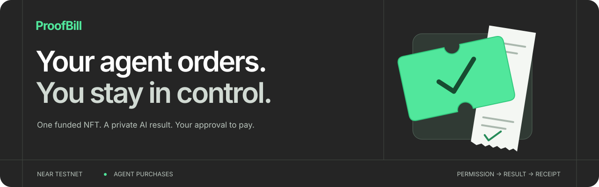
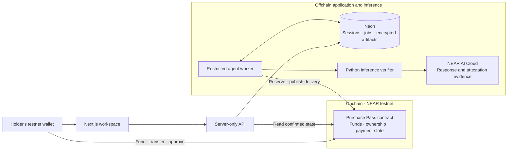

<p align="center">
  
</p>

<h1 align="center">ProofBill</h1>

<p align="center">
  A funded NFT Purchase Pass for an AI service.<br />
  A private result to inspect. You choose when payment is authorized.
</p>

<p align="center">
  <a href="https://github.com/EndPx/proofbill/actions/workflows/check.yml"></a>
  <a href="https://testnet.nearblocks.io/address/proofbill-endpx-2026.testnet"></a>
  <a href="LICENSE"></a>
</p>

<p align="center">
  <a href="https://proofbill-two.vercel.app"></a>
  <a href="#review-in-five-minutes"></a>
  <a href="docs/evidence/hosted-release.md"></a>
  <a href="#local-development"></a>
</p>

## Why ProofBill

When an agent uses a paid AI service, its owner needs to connect three things: **what was permitted, what came back, and what was actually paid**. Separate spending rules, response logs and transaction records make that review harder.

ProofBill puts that purchase into one lifecycle:

**Purchase Pass → chosen agent → private result and evidence → manual approval or preauthorized settlement → confirmed seller payment → receipt.**

The initial user is a developer or small team operating paid-API agents. The current service turns a short purchase brief into an item, quantity and requester. The agent has a bounded purchasing role; the holder chooses Manual approval or explicitly preauthorizes Automatic payment for that pass.

**Current state:** a live NEAR testnet MVP, with a recorded hosted purchase through Vercel, Neon, the worker, actual NEAR AI inference and the contract. [Inspect that journey](docs/evidence/integration/pass-2-order.json).

<p align="center">
  
</p>

<details>
<summary>View the mobile landing and application receipt</summary>

<p>
  
</p>


The receipt image is a recorded testnet snapshot. The [current app](https://proofbill-two.vercel.app/app/receipts/pass-2-order) first asks for a wallet connection; private output additionally requires the historical buyer's signed session.

</details>

## Review in five minutes

1. **Understand the product.** Open the [landing page](https://proofbill-two.vercel.app), click through the sample workspace menus, switch through the three purchase steps, and try the clearly labelled handover illustration. The interactive workspace uses local mock records; it needs no wallet or credits and submits no transactions.
2. **Inspect the working workspace.** [Connect a NEAR testnet wallet](https://proofbill-two.vercel.app/app/purchases). Open the [recorded receipt](https://proofbill-two.vercel.app/app/receipts/pass-2-order) to inspect public financial facts. Another wallet cannot unlock the buyer's private result.
3. **Check the payment independently.** Compare the [successful seller payment](https://testnet.nearblocks.io/txns/EKHAhwbEjwJos2sAzc7kxvHAnuA4aYS24H7TmjeeKj5Z), [duplicate-payment refusal](https://testnet.nearblocks.io/txns/68kMbxpYj3uxqekXBnJVwWEqATx2MrcTsTf6ENduXJZ1), and [integration record](docs/evidence/integration/pass-2-order.json). Reading these does not require a new purchase.
4. **Try your own purchase.** Use your own funded testnet wallet: create a pass, assign Research assistant, enter a brief, run the agent, unlock the result, and approve payment or request a refund where permitted. Funding and policy changes require your wallet signature. Manual payments require another approval; Automatic settlement uses advance authorization after matching publisher delivery. See [own-agent and payment-mode setup](docs/agent-integration.md).
5. **Review or reproduce the code.** Use the track/source map below, then run [local checks](#checks-and-reproduction). Browser tests use fixtures and need no signing or provider secrets.

The fixed service allocation is **0.010 native testnet NEAR**. Minting also reserves a separate **0.030 NEAR storage budget**, plus transaction gas. Storage backing is retained while its NFT/history exists and is not part of the service refund. The seller/operator pays inference credits independently of the later payout.

## Four track contributions

| Track | What is implemented | Where to inspect it |
| --- | --- | --- |
| **Agent Economy** | A named, restricted agent reserves one bound service order; actual execution leads to a separately approved seller payout. | [Agent worker](workers/agent/src/index.ts), [reservation transaction](https://testnet.nearblocks.io/txns/7L5yX1XcyydLyYdgsApsajWqoPrPUTAjXuCBwv3BusLk), [paid order](docs/evidence/integration/pass-2-order.json) |
| **AI Security & Defense** | Fixed seller/amount/expiry, holder and revision checks, method-restricted operational keys, single-use order, explicit pending/failure states and callback-driven payment. | [Contract](contracts/proofbill/src/lib.rs), [Sandbox cases](contracts/proofbill/tests/test_basics.rs), [duplicate refusal](https://testnet.nearblocks.io/txns/68kMbxpYj3uxqekXBnJVwWEqATx2MrcTsTf6ENduXJZ1) |
| **Privacy & Private AI** | Buyer-authenticated private reads, encrypted artifacts, exact-byte response checks and scoped model-serving TEE evidence from NEAR AI Cloud. | [Authentication](packages/server/src/auth.ts), [private API](apps/web/src/app/api/%5B...path%5D/route.ts), [inference verifier](workers/inference/inference.py), [response-probe scope](docs/evidence/near-ai-response-probe.md) |
| **NFTs That Do Something** | A funded NEP-171 purchase/refund entitlement follows ownership; unused transfer clears agent assignment, active orders lock transfer, and completion updates metadata. | [NFT and payment implementation](contracts/proofbill/src/lib.rs), [transfer transaction](https://testnet.nearblocks.io/txns/DcJ1hjcBDByvvY6SMgDNyBLBCYbeuYa4uxTaTqSfBt12), [receiver/ownership cases](contracts/proofbill/tests/test_basics.rs) |

These are implementation claims, not awards or a security certification. [The official NEAR Hackathon rules](https://nearhackathon.com/HACKATHON.md) govern submission eligibility and final track selection.

## Evidence you can inspect

| Evidence | What it establishes | Boundary |
| --- | --- | --- |
| [Hosted release](docs/evidence/hosted-release.md) and [pass-2-order record](docs/evidence/integration/pass-2-order.json) | The hosted API, private persistence, worker, inference and NEAR testnet purchase were exercised together. | Project-owned test accounts and synthetic input; not customer traction. |
| [Deployment identities](infra/near/testnet-deployment.json) | Public contract/operator IDs, deploy transaction, Wasm size and artifact hash. | A deployment record, not an audit or a claim that every later source commit was redeployed. |
| [Response verification probe](docs/evidence/near-ai-response-probe.md) | One actual response, its signature/preflight checks and the verifier's explicit limits. | Response integrity and stated execution context do not establish answer accuracy. |
| [MVP validation matrix](docs/evidence/mvp-validation.md) | Recorded auth, ownership, refusal, payment and local callback checks, with scope per row. | Local Sandbox uses a synthetic publisher; it is not provider-inference evidence. |
| [GitHub Actions](https://github.com/EndPx/proofbill/actions/workflows/check.yml) | Fresh-run typechecks, unit tests, production build and browser/accessibility journeys. | No paid inference, wallet signing or chain writes; Rust/Sandbox checks run separately. |

The hosted record contains a successful buyer read and denial for another authenticated account. Original private request/response artifacts are encrypted and are not made public through a receipt. Browser connection tests use an injected wallet fixture; the recorded integration exercised signatures through the SDK/API, not an automated human wallet confirmation.

## Architecture and trust



**Onchain state is the financial authority.** Neon holds private application state and observational references; a database row cannot authorize payment. The agent does not receive the holder's wallet key. Manual payment requires holder approval. Automatic payment uses explicit per-pass authorization after matching publisher delivery. Both modes require a successful seller-transfer callback before marking an order Paid.

**The evidence publisher remains trusted.** The contract accepts the application's offchain verification statement; it does not verify Intel/NVIDIA quotes onchain. The implemented verifier checks exact response bytes, the ECDSA signer and required Intel TDX/GPU preflight evidence. TLS connection binding and independent source/image allowlisting are **Not checked**; the NRAS JWT chain is not locally revalidated.

**Private does not mean operator-blind.** The operator processes plaintext while executing the service. Database credentials and artifact keys stay server-side; worker signing/provider keys are excluded from the web environment. See [the security policy](SECURITY.md) for reporting and trust boundaries.

## Repository map

| Path | Responsibility |
| --- | --- |
| [`apps/web`](apps/web) | Next.js landing, wallet entry, purchase workspace and private HTTP API |
| [`contracts/proofbill`](contracts/proofbill) | Rust Purchase Pass contract, native payment lifecycle and Sandbox cases |
| [`workers/agent`](workers/agent) | Restricted order execution, queue leasing and reconciliation |
| [`workers/inference`](workers/inference) | NEAR AI request, exact-byte signature and attestation checks |
| [`packages/shared`](packages/shared) | Public types, integer amounts and pass-rights helpers |
| [`packages/server`](packages/server) | Server-only auth, encryption, persistence and chain reads |
| [`infra`](infra) | Public deployment identities, worker service and deployment templates |
| [`docs/database`](docs/database/ERD.md) | ERD, primary/foreign keys and data ownership |
| [`docs/evidence`](docs/evidence/hosted-release.md) | Scoped execution records and public testnet references |
| [`docs/planning`](docs/planning/README.md) | Product and architecture decisions, retained as design context |

## Local development

**Web preview:** Node.js **24** and pnpm **10.21.0**.

```sh
git clone https://github.com/EndPx/proofbill.git
cd proofbill
pnpm install --frozen-lockfile
pnpm dev
```

Open `http://localhost:3000`. The landing page and wallet entry can be previewed without production credentials. An unconfigured preview cannot execute a purchase.

**Complete local service:** use your own database, testnet contract/accounts, NEAR AI key/credits, and Python **3.12** environment.

```sh
cp .env.example .env.local
# Fill the server-only values using your own services and accounts.
pnpm env:web
pnpm db:migrate
pnpm dev
```

Generate `ARTIFACT_ENCRYPTION_KEY` as 32 random bytes encoded as 64 hex characters. Use a dedicated Neon database. `pnpm env:web` copies only the web allowlist into `apps/web/.env.local`, excluding worker signing keys and the provider key. Never put credentials in `NEXT_PUBLIC_` variables.

Install [`workers/inference/requirements.txt`](workers/inference/requirements.txt) in an isolated Python 3.12 environment, set `PYTHON_BIN`, and configure method-restricted agent/publisher accounts. In another terminal, start the worker:

```sh
pnpm worker
```

The worker requires your own provisioned accounts and provider access. No operational keys are supplied by the repository. See [the architecture](docs/planning/TECHNICAL-DESIGN.md), [environment template](.env.example) and [contribution guide](CONTRIBUTING.md).

## Checks and reproduction

The [agent/payment release evidence](docs/evidence/agent-payment-hosted.md) records all four hosted combinations, a fresh own-agent CLI purchase, compatibility checks and recovery guards. Manual remains the default; Automatic settlement requires explicit owner authorization for the pass.

```sh
pnpm check
pnpm test
pnpm build
pnpm --filter @proofbill/web exec playwright install chromium
pnpm --filter @proofbill/web test:browser
```

The browser suite builds a production server on port 3215. On Linux, use `playwright install --with-deps chromium`. It covers wallet gating/restoration/disconnect, landing interactions, keyboard FAQ, reduced motion, no-JavaScript readability and accessibility. [CI](.github/workflows/check.yml) runs these checks without provider or signing secrets and preserves browser failure artifacts.

Queue ownership regression tests use real PostgreSQL row locks and controlled chain fixtures. Create an isolated database named `proofbill_queue_check`, set `QUEUE_TEST_DATABASE_URL`, and run `pnpm test:queue`. Each run creates and removes its own random schema. Never point this test at the application database. CI provisions its own PostgreSQL service. See [the ownership queue regression](docs/evidence/queue-ownership-regression.md) for scope and safety limits.

Contract tests require [the pinned Rust toolchain](contracts/proofbill/rust-toolchain.toml), cargo-near and Sandbox prerequisites. Windows contract validation was performed in WSL Ubuntu:

```sh
cd contracts/proofbill
cargo test --lib
cargo test --test test_basics -- --nocapture
```

These cover receiver keep/return/failure, transferred refund rights, failed native seller payout and the refund exit. `PROOFBILL_WASM` can select an already-built artifact; the default path builds with cargo-near.

[`workers/agent/src/e2e.ts`](workers/agent/src/e2e.ts) is an operator integration runner. It uses project-owned account keys, signs real testnet transactions and consumes actual inference credits. It is deliberately excluded from ordinary CI. If interrupted, inspect pass/job state and its `E2E_TOKEN_ID` resume path before creating another purchase. Set `E2E_TRANSFER_MODE=none` for an original-holder purchase, or `E2E_TRANSFER_MODE=unused` (the default) to transfer an unused pass before buying. Both transfer modes finish with private buyer access, confirmed settlement and duplicate-payment rejection. `E2E_AGENT_KIND=proofbill|external` and `E2E_PAYMENT_MODE=Manual|Automatic` select the agent/payment matrix.

## Deployment

- **Web/API:** Vercel project `proofbill`, connected to `EndPx/proofbill`, root `apps/web`, Node.js 24. GitHub is the frontend deployment source.
- **Private persistence:** a dedicated Neon database; database/artifact credentials are server-only Vercel variables.
- **Worker:** a separate non-login Linux user with the [systemd service](infra/systemd/proofbill-worker.service) and [deployment script](infra/deploy-worker.sh). Operational keys stay in the worker's private environment; full-access CLI keys are not copied there.
- **Contract:** `proofbill-endpx-2026.testnet`. [Inspect the contract](https://testnet.nearblocks.io/address/proofbill-endpx-2026.testnet) and [deployment record](infra/near/testnet-deployment.json).

## Current boundaries

ProofBill is a **testnet MVP**, not an audited or mainnet-ready product. Demand and willingness to pay have not been established by an independent pilot. The current agent executes one fixed service/model/seller; it does not shop across a marketplace.

The seller pays inference costs before buyer approval. A rejection/refund does not undo provider usage. Broader worker retry/ownership-race coverage and seller-accepted commercial terms remain work for a production version.

## Provenance, team and license

Conceptual inspiration: [Assay](https://github.com/trudransh/Assay), [MoneySwitch](https://github.com/dongsheng123132/moneyswitch) and [Kanmani](https://github.com/zkasuran/kanmani). ProofBill does not claim to invent evidence-linked payments; its focus is a transferable bounded purchase right and private AI service flow on NEAR. The landing point-morph shaders are adapted from Assay under MIT; see [third-party notices](THIRD_PARTY_NOTICES.md) for the pinned source and full license. Purchase geometry, content, scene behavior and React/GSAP integration are specific to ProofBill.

The build uses official Next.js/cargo-near scaffolds, NEAR SDK/contract standards, NEAR Connect and the libraries declared in the manifests and lockfiles. Development used AI coding assistance. Original logo/bitmap concepts and the selected landing illustration were generated with ChatGPT Image; screenshots depict the actual product. Public source and curated evidence are tracked; credentials, raw operational logs, working exports and internal review notes stay local.

**Independent-project disclosure:** the author also builds **ShowStake**, a separate NEAR event-commitment project that may enter the hackathon. ProofBill has separate financial state, contracts and budgets. It is not the same project submitted twice.

Built by **[Albary / EndPx](https://github.com/EndPx)** · [X](https://x.com/endpx_) · [MIT license](LICENSE) · [Contributing](CONTRIBUTING.md) · [Report a vulnerability privately](SECURITY.md)
