<p align="center"></p>

# ProofBill

**Give your agent a budget. Know what it bought. Pay once.**

ProofBill is a NEAR testnet application for controlled AI service purchases. A funded **NFT Purchase Pass** carries the right to one fixed-price purchase. Its holder assigns an agent, receives a private result with inspectable evidence, approves the exact seller payment, and keeps a reconciled receipt.

**Status: MVP implemented. One actual private-inference purchase has passed end to end on NEAR testnet. Hosted release validation is in progress.** Project-owned scripted accounts are test evidence, not traction. This is not audited or mainnet-ready.

## The problem

An agent's owner needs a clear connection between what was permitted, what arrived, and what was paid. Separate spending rules, response logs and transaction records make purchases harder to review and retries harder to reconcile.

ProofBill connects **Purchase Pass → exact order → response evidence → holder approval → final payment outcome → receipt**. The initial customer hypothesis is a developer or small team operating paid-API agents; demand and willingness to pay still need validation.

## The purchase flow

1. **Mint and fund a pass.** It binds one service, seller, model, fixed price and expiry. The first service extracts item, quantity and requester from a private purchase brief.
2. **Keep or transfer it.** An unused NFT transfers its purchase/refund entitlement to the new holder. Prior agent assignment is invalidated.
3. **Assign Research assistant.** A restricted operational agent key reserves the bound order. It does not receive the holder's wallet key or permission to approve payment.
4. **Inspect the private result.** NEAR AI Cloud supplies an actual response. The verifier checks exact bytes, model signature and required preflight evidence.
5. **Approve the exact payment.** The holder's wallet approves the stored order, seller, amount and evidence commitment. Only a successful transfer callback makes the order Paid.
6. **Keep a receipt.** The pass becomes Completed and cannot purchase again. An unused/rejected allocation has a confirmed-refund exit. Private history stays with the historical buyer after a terminal NFT transfer.

Service price is **0.010 native testnet NEAR**, plus a **0.030 storage budget** and wallet gas. Storage backing is retained while the NFT/history exists; it is separate from the service amount. The seller/operator pays NEAR AI inference credits independently of the later seller payout. Buyer rejection does not undo provider usage.

## Try the app

Use a NEAR **testnet** wallet with message-signing support. The inspected connector selector offered Meteor, Intear, Nightly, Ledger and NEAR CLI; the complete protocol was tested with project-owned account signatures. Browser wallet confirmation is a separate user-controlled step.

- Connect the wallet, then sign a non-transaction login message to unlock private features. Message login uses no gas.
- Create a Purchase Pass and confirm the funding transaction.
- Open it, assign Research assistant, enter a brief or use the synthetic example, then Run agent.
- Open the resulting order. Review its actual output and scoped checks, then approve payment or request a refund.
- Follow the confirmed receipt and linked NFT state. Public receipts exclude private prompts and results.

The web production URL is recorded after hosted validation. No seed phrase or private key is required by the web app.

## Four track contributions

| Track | Implemented contribution / evidence |
| --- | --- |
| Agent Economy | Restricted agent reservation, actual service execution and holder-approved seller payout |
| AI Security & Defense | Bound seller/amount/expiry, stale-holder refusal, one-order pass, duplicate-payment refusal and explicit pending/failure states |
| Privacy & Private AI | Wallet-authenticated buyer-only reads, encrypted private artifacts and actual model-serving TEE response evidence |
| NFTs That Do Something | Funded NEP-171 purchasing/refund right, unused transfer, active-order lock and terminal metadata |

The [official rules](https://nearhackathon.com/HACKATHON.md) govern final submission. Tests establish the stated slices, not a production security guarantee.

## Inspect the evidence

- [Completed real purchase: pass-1-order](docs/evidence/integration/pass-1-order.json)
- [Deploy/init transaction](https://testnet.nearblocks.io/txns/Awp98RaHMsffcfz9HqrLCaPR6WeCaWig3suGq816pyHY)
- [Seller payout transaction](https://testnet.nearblocks.io/txns/9s1TrL3tjWUFn4kuLY2JLfSkztN2MC8LAssPrebcp1vJ)
- [Rejected duplicate payment](https://testnet.nearblocks.io/txns/EEVzKgstU98jiwA4UbWL6U27REW3vXX13XRuc5kv94KU)
- [Standalone response-probe scope](docs/evidence/near-ai-response-probe.md)
- [Deployment identities and code hash](infra/near/testnet-deployment.json)

The real response contained structured output for synthetic workshop supplies. Original request/response and evidence are held in the encrypted buyer artifact, not exposed through the public receipt. Local Sandbox checks use a synthetic publisher to isolate contract behavior; they are not AI provenance evidence.

## Architecture and trust

```mermaid
flowchart LR
  U[Holder's testnet wallet] --> V[Vercel web and private API]
  U --> C[NEAR Purchase Pass contract]
  V --> D[Neon: sessions and encrypted jobs]
  W[Isolated agent worker] --> D
  W --> C
  W --> P[Local Python verifier]
  P --> A[NEAR AI Cloud and attestation services]
```



NEAR owns financial/NFT truth. Neon stores private application state and observational transaction references. The contract trusts a disclosed application publisher's offchain evidence statement, then separately requires holder payment approval; it does not verify Intel/NVIDIA quotes itself.

Required evidence includes explicit ECDSA `provider_tee`, exact-byte hashes, unique verified preflight signer, accepted Intel TDX and GPU evidence. TLS peer-SPKI binding and independent source/image allowlisting are **Not checked**. NRAS is trusted through authenticated HTTPS; its JWT signing chain is not locally revalidated. Signatures do not establish answer accuracy.

The app operator processes plaintext while executing the service. Do not interpret encrypted storage/TEE inference as an operator-blind or fully end-to-end-encrypted application. Private payloads are removed from active application storage seven days after an observed terminal outcome; explicit buyer erasure preserves public financial history.

Database credentials and artifact keys are server-only Vercel variables. API imports have a `server-only` boundary. Worker signing/provider keys are excluded from the web environment. The local browser-bundle check found no configured credential values.

## Source map

```text
apps/web/               Next.js UI and private API
contracts/proofbill/    Rust NEP-171 entitlement/payment contract and Sandbox tests
workers/agent/         Restricted agent, queue leasing and reconciliation
workers/inference/     Python exact-byte inference and attestation checks
packages/shared/       Public types and amount/rights helpers
packages/server/       Server-only persistence, encryption, chain/auth helpers
docs/database/         ERD, PK/FK, data ownership and relations
docs/planning/         Product decisions, architecture and delivery intent
docs/evidence/         Scoped, curated execution evidence
infra/                 Public deployment templates; no real secret values
```

## Local development

Prerequisites: Node.js 24, pnpm 10.21.0, Python 3.12; for contracts Rust 1.99.1, cargo-near 0.23.0 and near-cli-rs 0.31.1. Windows contract tests were run in WSL Ubuntu. Runtime tools should match the pinned manifests/locks.

```sh
pnpm install --frozen-lockfile
cp .env.example .env.local
# Fill your server-only configuration locally; never commit it.
pnpm env:web
pnpm db:migrate
pnpm dev
```

Generate `ARTIFACT_ENCRYPTION_KEY` as 32 random bytes encoded as 64 hex characters. Use a dedicated Neon database. Contract/agent/seller identities must refer to your real testnet setup; never invent deployment addresses. `tools/write-web-env.mjs` copies only the web allowlist, excluding operational signing keys and the provider key.

For a complete local service, install `workers/inference/requirements.txt` in an isolated Python 3.12 environment, set `PYTHON_BIN`, configure method-restricted agent/publisher keys, then run `pnpm worker` in another terminal. The operator's `provision.ts` reads locally owned CLI testnet keys; it does not contain or provide credentials.

## Checks

```sh
pnpm check
pnpm test
pnpm build
cd contracts/proofbill
cargo test --lib
cargo test --test test_basics -- --nocapture
```

The Wasm/Sandbox test covers receiver keep/return/failure behavior, transferred refund rights, failed native seller payout and the refund exit. Its default path builds using cargo-near; `PROOFBILL_WASM` can select an already-built artifact. The TypeScript tests check exact amounts, rights and authenticated encryption.

`workers/agent/src/e2e.ts` is an explicit operator test using project-owned testnet keys and **actual inference credits**. It signs real testnet transactions. If interrupted, inspect existing pass/job state and use its resume option rather than blindly creating another purchase.

## Deployment

Vercel project `proofbill` connects to `EndPx/proofbill` with root directory `apps/web` and Node.js 24. GitHub pushes are the frontend deployment source. Configure server secrets through Vercel environment management, never `NEXT_PUBLIC_` values.

The worker runs as a separate non-login Linux user through [the systemd unit](infra/systemd/proofbill-worker.service), with its local Python helper. [The deployment script](infra/deploy-worker.sh) owns only `/opt/proofbill` and that service. Its private env file contains restricted operational keys; full-access CLI keys stay on the operator's machine.

## Provenance and scope

Conceptual inspiration: [Assay](https://github.com/trudransh/Assay), [MoneySwitch](https://github.com/dongsheng123132/moneyswitch) and [Kanmani](https://github.com/zkasuran/kanmani). Assay and Kanmani have also documented paid-receipt interoperation; ProofBill makes no claim to invent evidence-linked payments. Its selected product focus is transferable bounded purchase rights and a private AI service flow on NEAR. No source from those projects is included.

Built using the official Next.js and cargo-near scaffolds, NEAR SDK/contract standards, NEAR Connect and the attestation libraries declared in the manifests. Design/logo bitmap concepts were generated with ChatGPT Image; prompts are retained under `design/`.

ProofBill is independent of the author's ShowStake NEAR event-commitment project, which may also enter the hackathon. They do not share financial state, contracts or budgets; reciprocal disclosure is required before submission.

Maintainer: **Albary / EndPx** — [GitHub](https://github.com/EndPx) · [X](https://x.com/endpx_). Original project code: [MIT](LICENSE).
