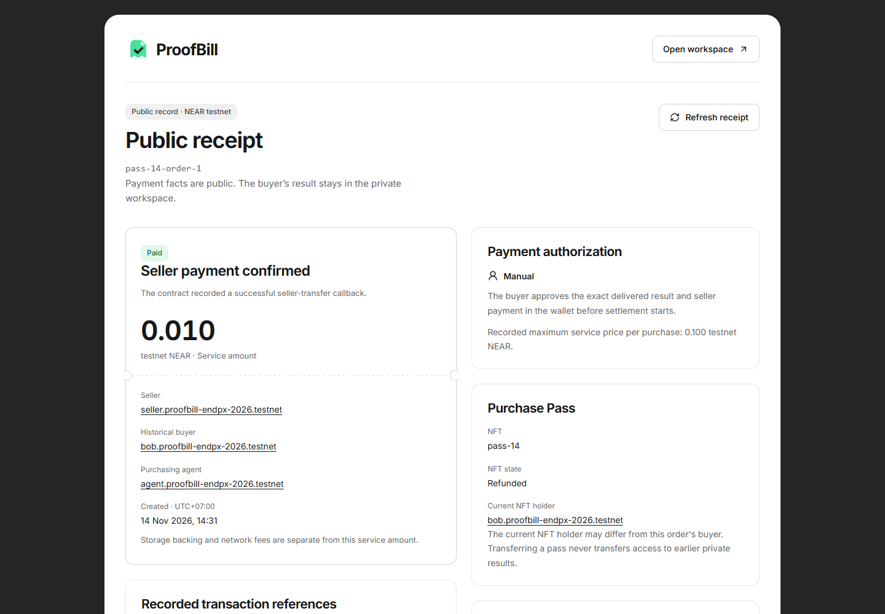
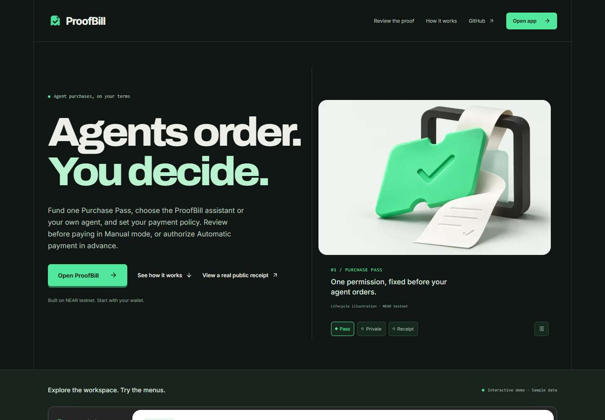
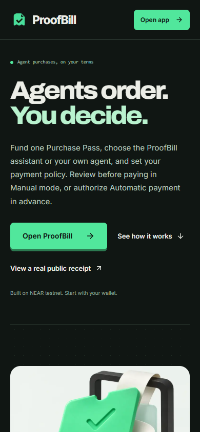
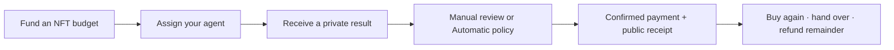
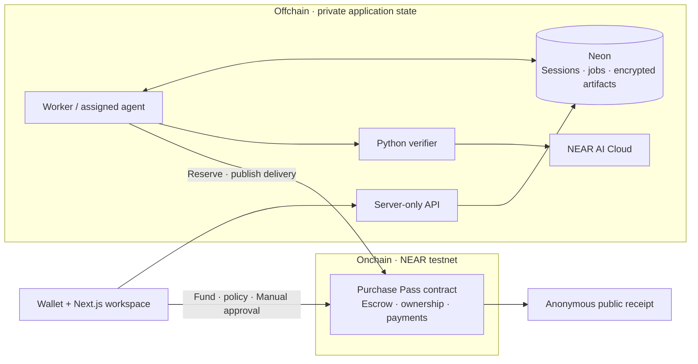

<p align="center">
  
</p>

<h1 align="center">ProofBill</h1>

<p align="center">
  Built with <strong>NEAR Protocol (testnet)</strong>, <strong>NEAR AI Cloud</strong> and <strong>NEP-171 NFTs</strong>.<br />
  Reusable agent budgets, buyer-private AI results and confirmed onchain payment receipts.
</p>

<p align="center">
  <a href="https://github.com/EndPx/proofbill/actions/workflows/check.yml"></a>
  <a href="https://testnet.nearblocks.io/address/proofbill-endpx-2026.testnet"></a>
  <a href="LICENSE"></a>
</p>

<p align="center">
  <a href="https://proofbill-two.vercel.app"></a>
  <a href="#review-in-five-minutes"></a>
  <a href="docs/evidence/flexible-budget-hosted.md"></a>
  <a href="#local-development"></a>
</p>

<p align="center">
  <a href="https://proofbill-two.vercel.app/receipts/pass-14-order-1">
    
  </a>
</p>

Actual NEAR testnet payment, captured 14 November 2026: **0.010 NEAR paid**, with the pass's separate **0.015 unused service budget refunded**. [Open the public receipt](https://proofbill-two.vercel.app/receipts/pass-14-order-1) or [inspect the recorded run](docs/evidence/tls-image-policy.md#hosted-rollout-and-actual-private-order). The buyer's private result is not pictured.

## Why ProofBill

An agent can call a paid API, but its owner still needs to answer: **what did I authorize, what did I receive, and who got paid?** ProofBill connects those three records in one purchase flow.

For developers and small teams running paid-API agents: fund one NFT budget, assign an agent, inspect private deliveries, and track confirmed payments. [Problem evidence and alternatives](docs/planning/PROBLEM-EVIDENCE.md).

## At a glance

| Capability | Current implementation | Inspect |
| --- | --- | --- |
| **Reusable budget** | Custom total + optional maximum per purchase; multiple orders from one NFT, one active order at a time. | [Two purchases, handover and refund](docs/evidence/flexible-budget-hosted.md) |
| **Your agent** | Use the ProofBill assistant or assign your own agent. The NFT stays with its owner. | [Agent SDK / CLI guide](docs/agent-integration.md) |
| **Payment choice** | Manual review per order, or advance Automatic authorization within the remaining budget. | [All four agent/payment combinations](docs/evidence/agent-payment-hosted.md) |
| **Private delivery** | Buyer-authenticated results, encrypted stored artifacts and a buyer-run evidence verifier. | [Verification guide](docs/verify-private-result.md) |
| **Public receipt** | Anyone can inspect payment facts without a wallet; plaintext briefs and results remain private. | [Open an actual receipt ↗](https://proofbill-two.vercel.app/receipts/pass-14-order-1) |

**Scope:** hosted **NEAR testnet MVP**; project-owned accounts and synthetic briefs. One fixed service, seller and model today. No independent user pilot, audit or mainnet-readiness claim.

<details>
<summary>Product screenshots — desktop and mobile</summary>

<p align="center">
  
</p>
<p align="center">
  
</p>

Actual public landing captures in reduced-motion mode. Lifecycle artwork is illustrative; the interactive workspace preview uses labelled local sample data. The receipt screenshot above depicts actual testnet payment facts.

</details>

## How a purchase works



| Owner chooses | What it controls |
| --- | --- |
| **Total service budget** | Funds available across repeated purchases. Unspent service funds can be refunded when the contract permits. |
| **Optional purchase limit** | Maximum allowed seller payment for one order. It caps a quote; it does not set the service price. |
| **Agent + expiry** | Who can reserve an order, and how long the permission lasts. |
| **Manual / Automatic** | Manual: inspect delivery, then approve the exact payment. Automatic: authorize payment in advance after matching publisher delivery; no final quality-review gate. |

**Example:** fund **1 NEAR**, optionally cap each purchase at **0.1 NEAR**. The current extraction quote is **0.010 NEAR**. Initial funding is **1.030 NEAR + gas**: 1 service budget + 0.030 separate storage backing. Retained history may require further storage deposits; service refunds exclude spent funds and retained storage.

The service extracts **item, quantity and requester** from a brief using `Qwen/Qwen3.8-27B`. It does not buy physical goods or shop across sellers. Transfer between orders hands over remaining spending/refund rights and clears the old agent, limit and Automatic permission. Historical private results stay with their original buyer.

## Review in five minutes

| Step | Open | What to check |
| --- | --- | --- |
| **1 · Explore** | [Public review journey](https://proofbill-two.vercel.app/review) | Budget → both payment policies → handover/refund. No wallet required. |
| **2 · Verify** | [Latest Manual receipt](https://proofbill-two.vercel.app/receipts/pass-14-order-1) · [seller transfer](https://testnet.nearblocks.io/txns/uYPUF6hYh58y6b5b39ZAh2abi7KAJxadqm1QzkLK6nj) | Receipt facts match the confirmed 0.010 testnet NEAR payment. |
| **3 · Try** | [Create a pass](https://proofbill-two.vercel.app/app/passes/new) | Use your own funded testnet wallet; choose budget, limit, agent and policy. Sign a buyer session to open private results. |
| **4 · Reproduce** | [Development guide](docs/development.md) · [own-agent setup](docs/agent-integration.md) | Local checks and the prerequisites for your own full purchase. |

The [landing preview](https://proofbill-two.vercel.app) is a wallet-free simulation. Trying the real app requires funding and wallet transactions; operator inference credits are separate.

## Evidence you can inspect

| Recorded execution | Result | Evidence |
| --- | --- | --- |
| **Custom budget · pass 13** | **1.2345 funded = 0.020 spent + 1.2145 refunded.** Two orders, Automatic then Manual; optional/removed limit, over-limit refusal and remainder transferred to a new holder. | [Run and transaction records](docs/evidence/flexible-budget-hosted.md) · [Automatic receipt](https://proofbill-two.vercel.app/receipts/pass-13-order-1) · [Manual receipt](https://proofbill-two.vercel.app/receipts/pass-13-order-2) |
| **Private delivery · pass 14** | **0.025 funded = 0.010 spent + 0.015 refunded.** Actual inference, authenticated buyer access, other-account denial, buyer export verification and tampered TLS evidence rejection. | [TLS/image-policy release](docs/evidence/tls-image-policy.md#hosted-rollout-and-actual-private-order) |
| **Restart + NFT callbacks** | Worker restart/recovery regressions, repeated asynchronous transfers and hosted compatibility checks. | [Recovery/storage release](docs/evidence/recovery-storage-release.md) |
| **Automated checks** | TypeScript, PostgreSQL, production browser journeys, Python verification, native Rust and actual Wasm/Sandbox. **No paid inference or public-chain writes in CI.** | [GitHub Actions](https://github.com/EndPx/proofbill/actions/workflows/check.yml) · [Reproduce](docs/development.md#checks-and-reproduction) |

Amounts above are service funds; storage and gas are separate. These are controlled project runs, not customer traction. [Deployment identities](infra/near/testnet-deployment.json) · [v4 contract artifact](infra/near/flexible-budget-upgrade.json).

## Four track contributions

| Track | NEAR technology and contribution | Source |
| --- | --- | --- |
| **Agent Economy** | Assigned hosted/external agents purchase within a reusable contract budget. | [Worker](workers/agent/src/index.ts) · [Agent SDK](packages/agent-client/src/index.ts) |
| **AI Security & Defense** | NEAR contract checks seller, amount, expiry, owner/revision and duplicate execution; payment becomes Paid only after its transfer callback succeeds. | [Rust contract](contracts/proofbill/src/lib.rs) · [Wasm/Sandbox cases](contracts/proofbill/tests/test_basics.rs) |
| **Privacy & Private AI** | NEAR AI Cloud response/attestation checks, gateway TLS binding, deployment policy and private buyer access through NEP-413 sessions. | [Inference verifier](workers/inference) · [Auth](packages/server/src/auth.ts) · [Buyer verifier](docs/verify-private-result.md) |
| **NFTs That Do Something** | NEP-171 ownership represents transferable remaining purchase/refund rights. Escrow stays in the contract, indexed by token ID. | [NFT implementation](contracts/proofbill/src/lib.rs) · [Handover evidence](docs/evidence/flexible-budget-hosted.md) |

Implementation map for the four intended tracks; [official rules](https://nearhackathon.com/HACKATHON.md) govern eligibility and final selection.

## Architecture and trust



| Boundary | What to know before funding |
| --- | --- |
| **Financial authority** | Under deployed code, the contract controls funds and final payment/refund state. Database rows cannot authorize payment. The agent never receives the holder's wallet key. Hosted automation uses method-restricted keys; the external SDK uses its own agent account's FullAccess key. |
| **Contract administrator** | The testnet contract retained a **FullAccess key** in the 14 November 2026 check. Its holder can move contract-held NEAR, manage keys and replace code outside app approval methods. Rules are **not immutable against this administrator**. [Details](SECURITY.md#contract-administration). |
| **Evidence publisher** | Trusted to publish the offchain verification statement; the contract does **not** verify TEE quotes onchain. Automatic relies on that statement under advance authorization. Failed seller transfers require buyer-approved retries in either mode. |
| **Response evidence** | Exact bytes/signature, TDX/GPU evidence, authenticated NRAS JWTs, gateway TLS binding and approved deployment pins are checked. Full model/dependency build provenance, current execution, weights and answer quality are **not established**. A buyer cannot re-observe the historical worker socket; old exports retain their original scope. [Verification scope](docs/evidence/tls-image-policy.md). |
| **Privacy** | Buyer sessions gate results; stored artifacts use AES-256-GCM. The operator processes plaintext during execution: **not operator-blind**. Public financial metadata remains onchain. [Security policy](SECURITY.md). |
| **Commercial limits** | No independent pilot yet. In Manual mode the seller incurs inference cost before buyer approval; refusal does not undo that cost. Pricing and seller acceptance remain unvalidated. |

## Repository map

| Area | Location | Role |
| --- | --- | --- |
| **Web + API** | [`apps/web`](apps/web) | Landing, wallet entry, workspace, private API and public receipts. |
| **Contract** | [`contracts/proofbill`](contracts/proofbill) | Rust escrow, NFT rights and payment/refund callbacks. |
| **Execution** | [`workers/agent`](workers/agent) · [`workers/inference`](workers/inference) | Agent jobs, recovery and response verification. |
| **Shared code** | [`packages`](packages) | Agent SDK, auth, encryption, persistence and integer amount helpers. |
| **Operations + evidence** | [`infra`](infra) · [`docs`](docs) | Deployment identities, [ERD](docs/database/ERD.md), [design](docs/planning/TECHNICAL-DESIGN.md) and scoped execution records. |

## Local development

Node.js **24** · pnpm **10.21.0**. Preview the landing and wallet entry without production credentials:

```sh
git clone https://github.com/EndPx/proofbill.git
cd proofbill
pnpm install --frozen-lockfile
pnpm dev
```

Open `http://localhost:3000`. An unconfigured preview cannot execute purchases. For your own database, encryption key, testnet accounts and funded NEAR AI access, follow the [complete service setup](docs/development.md#local-development). Credentials stay server-side and out of Git.

## Checks and reproduction

```sh
pnpm check
pnpm test
pnpm build
```

[Full reproduction guide](docs/development.md#checks-and-reproduction): browser suite, isolated PostgreSQL checks, Python/inference prerequisites, Rust/Wasm Sandbox and the real testnet operator runner. Fixtures do not prove live provider or wallet execution.

## Provenance, team and license

Built by **[Albary / EndPx](https://github.com/EndPx)** · [X](https://x.com/endpx_) · [MIT](LICENSE) · [Contributing](CONTRIBUTING.md) · [Private security reports](SECURITY.md).

Inspired by [Assay](https://github.com/trudransh/Assay), [MoneySwitch](https://github.com/dongsheng123132/moneyswitch) and [Kanmani](https://github.com/zkasuran/kanmani). Landing point-morph shaders adapt Assay's MIT source; see [third-party notices](THIRD_PARTY_NOTICES.md). ProofBill's focus is transferable bounded purchase rights and private AI delivery on NEAR. Development used AI coding assistance and official scaffolds/libraries; original bitmap concepts were generated with ChatGPT Image. Screenshots show the actual product.

**Independent-project disclosure:** Albary also builds **ShowStake**, a separate NEAR event-commitment project that may enter the hackathon. Its financial state, contracts and budgets are separate.
