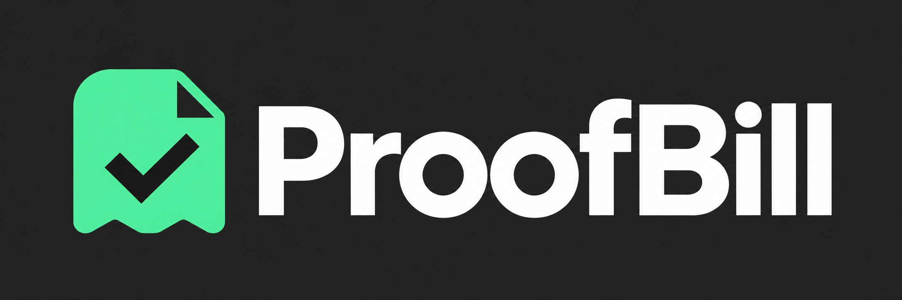
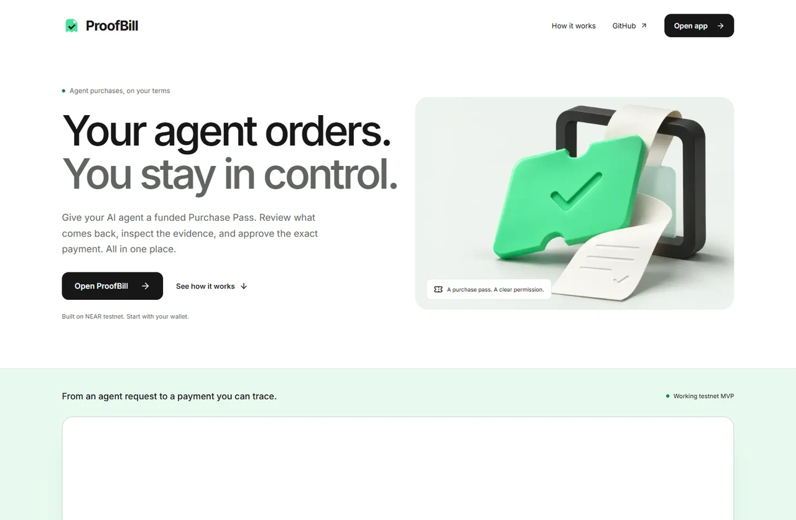
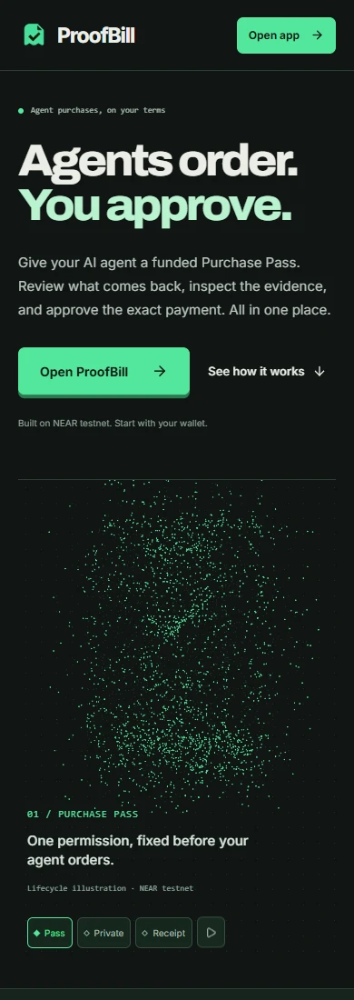
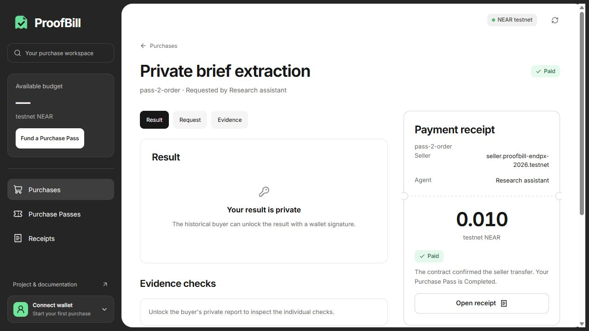
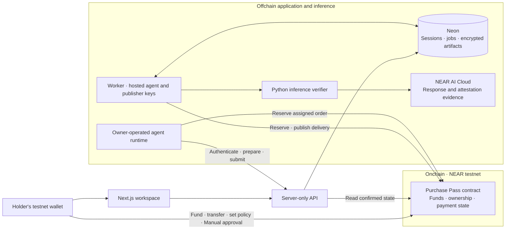

<p align="center">
  
</p>

<h1 align="center">ProofBill</h1>

<p align="center">
  A funded NFT Purchase Pass for an AI service.<br />
  A private result to inspect. You choose when payment is authorized.
</p>

<p align="center">
  <a href="https://github.com/EndPx/proofbill/actions/workflows/check.yml"></a>
  <a href="https://testnet.nearblocks.io/address/proofbill-endpx-2026.testnet"></a>
  <a href="LICENSE"></a>
</p>

<p align="center">
  <a href="https://proofbill-two.vercel.app"></a>
  <a href="#review-in-five-minutes"></a>
  <a href="docs/evidence/flexible-budget-hosted.md"></a>
  <a href="#local-development"></a>
</p>

## Why ProofBill

When an agent uses a paid AI service, its owner needs to connect three things: **what was permitted, what came back, and what was actually paid**. Separate spending rules, response logs and transaction records make that review harder.

Public agent-security guidance supports separating execution permission from an agent's reasoning, while agent research describes the friction of repeated approval prompts. Our [problem evidence and first-user plan](docs/planning/PROBLEM-EVIDENCE.md) links the original sources, compares ordinary budgets/wallets and explains the NFT tradeoff. These are external problem signals; independent ProofBill user validation is still pending.

ProofBill puts that purchase into one lifecycle:

**Fund a Purchase Pass budget → chosen agent orders → private result and evidence → Manual approval or preauthorized settlement → confirmed seller payment and receipt → use the remaining budget again or refund it.**

The initial user is a developer or small team operating paid-API agents. The current service turns a short purchase brief into an item, quantity and requester. The holder chooses a total service budget, agent, expiry and payment policy. Each order has a fixed price and seller, with only one active order per pass. Manual approval applies per order; Automatic authorizes purchases within the remaining budget.

**Current state:** a hosted NEAR testnet MVP. Both the ProofBill assistant and owner-operated agents have completed Manual and Automatic purchases through Vercel, Neon, the worker, actual NEAR AI inference and the contract. [Inspect the four combinations](docs/evidence/agent-payment-hosted.md), [recovery/storage release](docs/evidence/recovery-storage-release.md) and [anonymous public receipts](docs/evidence/public-receipts.md).

Version 3 adds [reusable NFT budgets](docs/evidence/budget-pass-hosted.md) and [buyer-run private evidence verification](docs/verify-private-result.md). One real NFT funded Automatic and Manual purchases, transferred its remaining entitlement, and refunded only the unspent allocation to the new holder. A buyer export passed independent checking; a tampered copy was rejected. Earlier single-use passes keep their original behavior; dated reports identify which version was exercised.

Version 4 is [hosted and exercised with a custom 1.2345 budget](docs/evidence/flexible-budget-hosted.md), optional/removed per-purchase ceilings, two real payments and exact residual refund to a new NFT holder. A ceiling bounds an individual seller payment; it does not choose the merchant price. [Contract checks](docs/evidence/flexible-budget-contract.md), [application checks](docs/evidence/flexible-budget-application.md) and deployment records identify the exact scope and tested artifact.

<p align="center">
  
</p>

<details>
<summary>View the mobile landing and application receipt</summary>

<p>
  
</p>



The receipt image is a recorded testnet snapshot. The [public receipt](https://proofbill-two.vercel.app/receipts/pass-2-order) shows finalized financial facts without a wallet. Workspace access requires a wallet connection; private output additionally requires the historical buyer's signed session.

</details>

## Review in five minutes

Start with the [public review journey](https://proofbill-two.vercel.app/review): one recorded budget, both payment policies, actual public receipts, handover/refund and the buyer-verification boundary. No wallet is needed to inspect it. The landing sample remains explicitly simulated; this guide links recorded execution evidence.

1. **Understand the product.** Open the [landing page](https://proofbill-two.vercel.app), create a sample budget in the interactive workspace, choose a hosted/custom sample agent and Manual/Automatic payment, then repeat purchases with that same pass. The preview uses local mock records and the shared funding quote helper; it needs no wallet or credits and submits no transactions. The prominent real-receipt link opens actual anonymous financial facts separately.
2. **Inspect a real public receipt.** Open the [Manual example](https://proofbill-two.vercel.app/receipts/pass-2-order) or [Automatic example](https://proofbill-two.vercel.app/receipts/pass-10-order) without connecting a wallet. The [workspace](https://proofbill-two.vercel.app/app/purchases) remains wallet-gated; another wallet cannot unlock the buyer's private result.
3. **Check the payment independently.** Compare the [successful seller payment](https://testnet.nearblocks.io/txns/EKHAhwbEjwJos2sAzc7kxvHAnuA4aYS24H7TmjeeKj5Z), [duplicate-payment refusal](https://testnet.nearblocks.io/txns/68kMbxpYj3uxqekXBnJVwWEqATx2MrcTsTf6ENduXJZ1), and [integration record](docs/evidence/integration/pass-2-order.json). Reading these does not require a new purchase.
4. **Try your own purchase.** Use your own funded testnet wallet: create a pass, choose the ProofBill assistant or your own agent, and set the payment policy before ordering. With the ProofBill assistant, enter a brief and run the agent; for your own agent, follow the [SDK/CLI setup](docs/agent-integration.md). Sign a buyer session to unlock the result. Manual payment requires your approval after review; Automatic settlement starts after matching publisher delivery under your advance authorization. Refund actions depend on contract state. Funding and policy changes require a wallet transaction.
5. **Review or reproduce the code.** Use the track/source map below, then run [local checks](#checks-and-reproduction). Browser tests use fixtures and need no signing or provider secrets.

The current service quote is **0.010 native testnet NEAR**. Version 4 accepts a custom total covering that quote, without a price-step or 1 NEAR ceiling. An optional maximum limits each purchase; it does not set the seller's price. Initial storage backing starts at **0.030 NEAR independently of the service total**, with wallet gas separate. A 1 NEAR service budget and optional 0.1 ceiling therefore start at 1.030 NEAR plus gas, not 2.030. Actual retained history consumes backing and can require a separate owner top-up later; this is not a promise that 0.030 covers every future order. Service refund excludes prior seller payments and storage. Legacy v3/single-use passes retain their original rules. Operator inference credits are separate from these native amounts.

## Four track contributions

| Track | What is implemented | Where to inspect it |
| --- | --- | --- |
| **Agent Economy** | The ProofBill assistant or an external agent reserves numbered orders within a funded NFT budget. Owner policy controls fixed-price seller payouts; exhausted budgets and stale task reruns cannot silently buy again. | [Agent worker](workers/agent/src/index.ts), [own-agent SDK](packages/agent-client/src/index.ts), [budget checks](docs/evidence/budget-pass-application.md) |
| **AI Security & Defense** | Fixed seller/amount/expiry, holder and revision checks, method-restricted operational keys, single-use order, explicit pending/failure states and callback-driven payment. | [Contract](contracts/proofbill/src/lib.rs), [Sandbox cases](contracts/proofbill/tests/test_basics.rs), [duplicate refusal](https://testnet.nearblocks.io/txns/68kMbxpYj3uxqekXBnJVwWEqATx2MrcTsTf6ENduXJZ1) |
| **Privacy & Private AI** | Buyer-authenticated private reads, encrypted artifacts, scoped NEAR AI TEE/signature checks and a buyer-run verifier that checks private delivery bytes against onchain commitments. | [Authentication](packages/server/src/auth.ts), [private API](apps/web/src/app/api/%5B...path%5D/route.ts), [buyer verification](docs/verify-private-result.md), [verification scope](docs/evidence/near-ai-response-probe.md) |
| **NFTs That Do Something** | A funded NEP-171 budget carries remaining purchase/refund rights between holders. Transfer clears agent/Automatic authorization, active orders lock transfer, and historical buyer access stays separate. | [NFT and budget implementation](contracts/proofbill/src/lib.rs), [budget callback/handover cases](contracts/proofbill/tests/test_basics.rs), [legacy transfer](https://testnet.nearblocks.io/txns/DcJ1hjcBDByvvY6SMgDNyBLBCYbeuYa4uxTaTqSfBt12) |

These are implementation claims, not awards or a security certification. [The official NEAR Hackathon rules](https://nearhackathon.com/HACKATHON.md) govern submission eligibility and final track selection.

## Evidence you can inspect

| Evidence | What it establishes | Boundary |
| --- | --- | --- |
| [Custom budget and spending limits](docs/evidence/flexible-budget-hosted.md) | Arbitrary total, optional/removed ceiling, real over-limit refusal, independent storage deposit, two actual purchases and exact residual handover/refund. | Project-owned accounts and synthetic briefs; no independent customer validation or mainnet claim. |
| [Reusable budget and buyer verification](docs/evidence/budget-pass-hosted.md) | Two real purchases from one NFT, remaining-budget handover/refund, historical buyer access and verification/tampering checks on a real response export. | Project-owned accounts/synthetic briefs; historical response evidence, no new completion during re-verification. |
| [Agent/payment release](docs/evidence/agent-payment-hosted.md), [recovery/storage release](docs/evidence/recovery-storage-release.md) and [public receipts](docs/evidence/public-receipts.md) | Hosted agent/payment combinations, restart and storage regressions, and anonymous receipt access with private boundaries intact. | Each report separates local fixtures from real provider/testnet checks; no mainnet or independent customer claim. |
| [Hosted release](docs/evidence/hosted-release.md) and [pass-2-order record](docs/evidence/integration/pass-2-order.json) | The hosted API, private persistence, worker, inference and NEAR testnet purchase were exercised together. | Project-owned test accounts and synthetic input; not customer traction. |
| [Deployment identities](infra/near/testnet-deployment.json) | Public contract/operator IDs, deploy transaction, Wasm size and artifact hash. | A deployment record, not an audit or a claim that every later source commit was redeployed. |
| [Response verification probe](docs/evidence/near-ai-response-probe.md) | One actual response, its signature/preflight checks and the verifier's explicit limits. | Response integrity and stated execution context do not establish answer accuracy. |
| [MVP validation matrix](docs/evidence/mvp-validation.md) | Recorded auth, ownership, refusal, payment and local callback checks, with scope per row. | Local Sandbox uses a synthetic publisher; it is not provider-inference evidence. |
| [GitHub Actions](https://github.com/EndPx/proofbill/actions/workflows/check.yml) | Typechecks, application/retention tests, production build, browser journeys, Python evidence checks and pinned Rust/cargo-near/Wasm Sandbox checks. | No paid inference, real wallet signing or public-chain writes; Sandbox uses synthetic publisher data. |

The hosted record contains a successful buyer read and denial for another authenticated account. Original private request/response artifacts are encrypted and are not made public through a receipt. Browser connection tests use an injected wallet fixture; the recorded integration exercised signatures through the SDK/API, not an automated human wallet confirmation.

## Architecture and trust



**Onchain state is the financial authority.** Neon holds private application state and observational references; a database row cannot authorize payment. The agent does not receive the holder's wallet key. Manual payment requires holder approval. Automatic payment uses explicit per-pass authorization after matching publisher delivery. Both modes require a successful seller-transfer callback before marking an order Paid.

The **holder** is the current NFT owner and controls an unused pass. The **buyer** is recorded at reservation and retains private result access after a completed NFT transfers. Hosted operational keys are method-restricted; the external-agent SDK currently authenticates with its own dedicated account's FullAccess key, kept in that runtime. It never receives the holder's key. A failed seller transfer requires buyer approval to retry in either payment mode.

**The evidence publisher remains trusted.** The contract accepts the application's offchain verification statement; it does not verify Intel/NVIDIA quotes onchain. The implemented verifier checks exact response bytes, the ECDSA signer and required Intel TDX/GPU preflight evidence. TLS connection binding and independent source/image allowlisting are **Not checked**; the NRAS JWT chain is not locally revalidated.

**Private does not mean operator-blind.** The operator processes plaintext while executing the service. Database credentials and artifact keys stay server-side; worker signing/provider keys are excluded from the web environment. See [the security policy](SECURITY.md) for reporting and trust boundaries.

## Repository map

| Path | Responsibility |
| --- | --- |
| [`apps/web`](apps/web) | Next.js landing, anonymous public receipts, wallet entry, purchase workspace and private HTTP API |
| [`contracts/proofbill`](contracts/proofbill) | Rust Purchase Pass contract, native payment lifecycle and Sandbox cases |
| [`workers/agent`](workers/agent) | Hosted order execution, own-agent CLI, queue leasing and reconciliation |
| [`packages/agent-client`](packages/agent-client) | Owner-operated agent authentication and reservation SDK |
| [`workers/inference`](workers/inference) | NEAR AI request, exact-byte signature and attestation checks |
| [`packages/shared`](packages/shared) | Public types, integer amounts and pass-rights helpers |
| [`packages/server`](packages/server) | Server-only auth, encryption, persistence and chain reads |
| [`infra`](infra) | Public deployment identities, worker service and deployment templates |
| [`docs/database`](docs/database/ERD.md) | ERD, primary/foreign keys and data ownership |
| [`docs/evidence`](docs/evidence/hosted-release.md) | Scoped execution records and public testnet references |
| [`docs/planning`](docs/planning/README.md) | Product and architecture decisions, retained as design context |

## Local development

**Web preview:** Node.js **24** and pnpm **10.21.0**.

```sh
git clone https://github.com/EndPx/proofbill.git
cd proofbill
pnpm install --frozen-lockfile
pnpm dev
```

Open `http://localhost:3000`. The landing page and wallet entry can be previewed without production credentials. An unconfigured preview cannot execute a purchase.

**Complete local service:** use your own database, testnet contract/accounts, NEAR AI key/credits, and Python **3.12** environment.

```sh
cp .env.example .env.local
# Fill the server-only values using your own services and accounts.
pnpm env:web
pnpm db:migrate
pnpm dev
```

Generate `ARTIFACT_ENCRYPTION_KEY` as 32 random bytes encoded as 64 hex characters. Use a dedicated Neon database. `pnpm env:web` copies only the web allowlist into `apps/web/.env.local`, excluding worker signing keys and the provider key. Never put credentials in `NEXT_PUBLIC_` variables.

Install [`workers/inference/requirements.txt`](workers/inference/requirements.txt) in an isolated Python 3.12 environment, set `PYTHON_BIN`, and configure method-restricted agent/publisher accounts. In another terminal, start the worker:

```sh
pnpm worker
```

The worker requires your own provisioned accounts and provider access. No operational keys are supplied by the repository. See [the architecture](docs/planning/TECHNICAL-DESIGN.md), [environment template](.env.example) and [contribution guide](CONTRIBUTING.md).

## Checks and reproduction

The [agent/payment release evidence](docs/evidence/agent-payment-hosted.md) records all four hosted combinations, a fresh own-agent CLI purchase, compatibility checks and recovery guards. Manual remains the default; Automatic settlement requires explicit owner authorization for the pass.

The later [recovery/storage release](docs/evidence/recovery-storage-release.md) records restart fault tests, same-token asynchronous transfer regressions, a new hosted purchase and repeated live testnet returns/refund.

```sh
pnpm check
pnpm test
pnpm build
pnpm --filter @proofbill/web exec playwright install chromium
pnpm --filter @proofbill/web test:browser
```

The browser suite builds a production server on port 3215. On Linux, use `playwright install --with-deps chromium`. It covers wallet gating/restoration/disconnect, landing interactions, keyboard FAQ, reduced motion, no-JavaScript readability and accessibility. [CI](.github/workflows/check.yml) runs these checks without provider or signing secrets and preserves browser failure artifacts.

Queue ownership regression tests use real PostgreSQL row locks and controlled chain fixtures. Create an isolated database named `proofbill_queue_check`, set `QUEUE_TEST_DATABASE_URL`, and run `pnpm test:queue`. Each run creates and removes its own random schema. Never point this test at the application database. CI provisions its own PostgreSQL service. See [the ownership queue regression](docs/evidence/queue-ownership-regression.md) for scope and safety limits.

Run `pnpm test:recovery` with the same isolated database to test actual killed/restarted Node processes, lease fencing, saved-result publication and unknown-provider handling. Its RPC/provider/payment boundaries are durable fixtures, with no paid inference or live signing. See [worker recovery evidence](docs/evidence/worker-recovery.md).

Run `pnpm test:retention` against that isolated database for persistent fair scanning, RPC failure isolation, seven-day erasure and contract scoping. [Retention checks](docs/evidence/retention-fairness.md) cover a Paid job behind more than twenty unresolved records without accessing live private payloads.

Contract CI uses [Rust 1.99.1](contracts/proofbill/rust-toolchain.toml), checksum-pinned cargo-near 0.22.0 and Ubuntu 24.04. It checks formatting, runs native unit tests, builds the official NEAR Wasm, then passes that exact artifact to Sandbox. Wasm/ABI artifacts are retained in the workflow. Local Linux reproduction:

```sh
cd contracts/proofbill
cargo test --lib
cargo near build non-reproducible-wasm --locked
PROOFBILL_WASM=target/near/proofbill.wasm cargo test --test test_basics --locked -- --nocapture
```

These cover receiver keep/return/failure, transferred refund rights, failed native seller payout and the refund exit. `PROOFBILL_WASM` can select an already-built artifact; the default path builds with cargo-near.

[`workers/agent/src/e2e.ts`](workers/agent/src/e2e.ts) is an operator integration runner. It uses project-owned account keys, signs real testnet transactions and consumes actual inference credits. It is deliberately excluded from ordinary CI. If interrupted, inspect pass/job state and its `E2E_TOKEN_ID` resume path before creating another purchase. Set `E2E_TRANSFER_MODE=none` for an original-holder purchase, or `E2E_TRANSFER_MODE=unused` (the default) to transfer an unused pass before buying. Both transfer modes finish with private buyer access, confirmed settlement and duplicate-payment rejection. `E2E_AGENT_KIND=proofbill|external` and `E2E_PAYMENT_MODE=Manual|Automatic` select the agent/payment matrix.

## Deployment

- **Web/API:** Vercel project `proofbill`, connected to `EndPx/proofbill`, root `apps/web`, Node.js 24. GitHub is the frontend deployment source.
- **Private persistence:** a dedicated Neon database; database/artifact credentials are server-only Vercel variables.
- **Worker:** a separate non-login Linux user with the [systemd service](infra/systemd/proofbill-worker.service) and [deployment script](infra/deploy-worker.sh). Operational keys stay in the worker's private environment; full-access CLI keys are not copied there.
- **Contract:** `proofbill-endpx-2026.testnet`. [Inspect the contract](https://testnet.nearblocks.io/address/proofbill-endpx-2026.testnet) and [deployment record](infra/near/testnet-deployment.json).

## Current boundaries

ProofBill is a **testnet MVP**, not an audited or mainnet-ready product. Demand and willingness to pay have not been established by an independent pilot. The current agent executes one fixed service/model/seller; it does not shop across a marketplace.

In Manual mode, the seller pays inference costs before buyer approval; rejection/refund does not undo provider usage. Automatic mode uses advance authorization and has no final semantic-review gate. Broader fault coverage and seller-accepted commercial terms remain work for a production version.

## Provenance, team and license

Conceptual inspiration: [Assay](https://github.com/trudransh/Assay), [MoneySwitch](https://github.com/dongsheng123132/moneyswitch) and [Kanmani](https://github.com/zkasuran/kanmani). ProofBill does not claim to invent evidence-linked payments; its focus is a transferable bounded purchase right and private AI service flow on NEAR. The landing point-morph shaders are adapted from Assay under MIT; see [third-party notices](THIRD_PARTY_NOTICES.md) for the pinned source and full license. Purchase geometry, content, scene behavior and React/GSAP integration are specific to ProofBill.

The build uses official Next.js/cargo-near scaffolds, NEAR SDK/contract standards, NEAR Connect and the libraries declared in the manifests and lockfiles. Development used AI coding assistance. Original logo/bitmap concepts and the selected landing illustration were generated with ChatGPT Image; screenshots depict the actual product. Public source and curated evidence are tracked; credentials, raw operational logs, working exports and internal review notes stay local.

**Independent-project disclosure:** the author also builds **ShowStake**, a separate NEAR event-commitment project that may enter the hackathon. ProofBill has separate financial state, contracts and budgets. It is not the same project submitted twice.

Built by **[Albary / EndPx](https://github.com/EndPx)** · [X](https://x.com/endpx_) · [MIT license](LICENSE) · [Contributing](CONTRIBUTING.md) · [Report a vulnerability privately](SECURITY.md)
