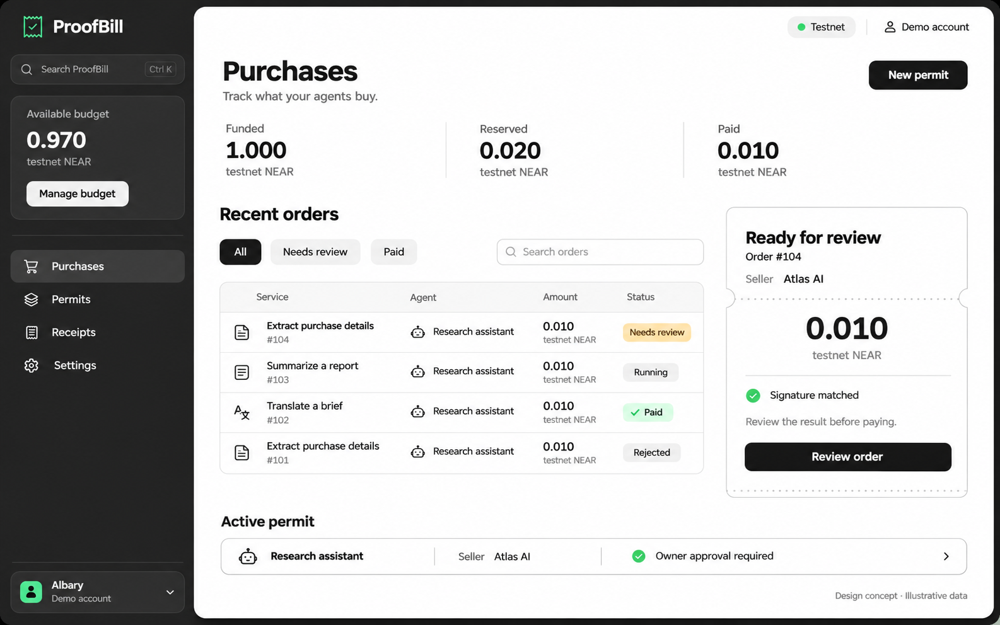
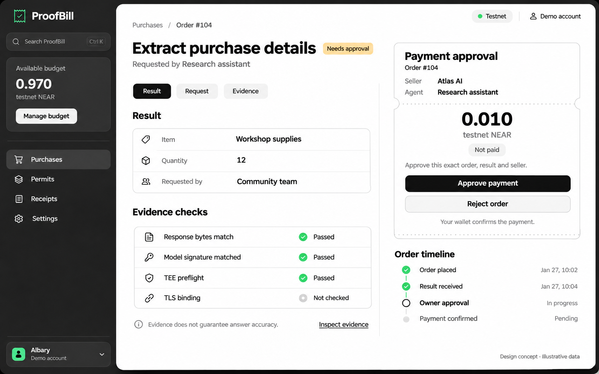

  

# ProofBill

**Give your agent a budget. Know what it bought. Pay once.**

ProofBill is a NEAR hackathon project for controlled AI service purchases. A funded **NFT Purchase Pass** carries the right to one bounded purchase. The holder assigns a purchasing agent, inspects the private result and its evidence, approves the exact seller payment, and receives a reconciled receipt.

**Status: product planning and one-response feasibility probe complete. Application and contract implementation have not started.** Screens below are design concepts with illustrative data. There is no live app or deployed ProofBill contract yet.

## The problem

When an AI agent buys a service, its owner needs a clear connection between what was authorized, what was delivered, and what was paid. Separate spending rules, response logs and payment records make it difficult to review a purchase or resolve a retry without uncertainty.

ProofBill's proposed connection is:

**Purchase Pass → exact order → response evidence → holder approval → payment outcome → receipt.**

The first target user is a developer or small team already running paid-API agents. Demand and willingness to pay remain hypotheses to validate; there are no claimed customers, adoption figures or measured savings.

## The planned experience

1. **Create a Purchase Pass.** Fund one fixed-price service purchase in native testnet NEAR. Storage and gas are separate from the service quote.
2. **Keep it or transfer it.** Before use, the NFT and its unspent purchase/refund entitlement can move to a new holder. Prior agent authority is invalidated.
3. **Assign an agent and send a private task.** The assigned agent reserves the exact order under the pass's seller, price and expiry rules.
4. **Inspect the result and its evidence.** The first service extracts structured fields from a short purchase brief using NEAR AI Cloud.
5. **Approve the exact payment.** The holder reviews the result and confirms the bound seller, amount and delivery commitment in their wallet.
6. **Receive the receipt.** A confirmed seller payout produces the Paid state and updates the NFT to Completed. The order cannot be paid a second time.

The pass is intended to be functional: current ownership controls a real purchasing/refund entitlement. It is locked while an order or financial transfer is in flight. Transferring a completed zero-value pass does not disclose a former buyer's private prompt or result.

## What has actually been proven

One actual NEAR AI Cloud response from `Qwen/Qwen3.8-27B` was checked against preflight evidence captured and verified before inference. The response carried an ECDSA `provider_tee` signature. Exact request/response hashes and the recovered signer matched the retained evidence. Offline checks rejected modified request and response bytes.

This is a **bounded cryptographic feasibility result**, not an implemented purchase flow or a security audit. It does not establish semantic answer correctness, an independently approved source/image measurement, or a complete model-to-gateway-to-TLS chain.

- [Probe report and scope](docs/evidence/near-ai-response-probe.md)
- [Retained synthetic request, response, signature and dated preflight evidence](docs/evidence/near-ai-response-probe/)

No NFT, seller payout, refund, private application session or deployed contract has been demonstrated yet. Those are build targets below.

## Four build targets

| Track | Planned product contribution |
| --- | --- |
| Agent Economy | An assigned agent purchases a service under a bounded NFT entitlement |
| AI Security & Defense | Enforced seller/amount/expiry rules, stale-owner refusal and duplicate-payment protection |
| Privacy & Private AI | Actual NEAR AI evidence, private inputs/results and explicit application trust boundaries |
| NFTs That Do Something | A transferable unused Purchase Pass whose ownership controls purchasing/refund rights |

These are implementation targets, not claims of completed track requirements. The [NEAR Hackathon rules](https://nearhackathon.com/HACKATHON.md) govern final submission.

## Product direction

The selected design uses a charcoal outer frame/sidebar, one rounded white content sheet, black primary actions and small mint/amber status accents. The next UI revision will replace the older Permits terminology in these concepts with Purchase Passes. All displayed balances, sellers, dates and order states are illustrative.

- [Selected logo assets](design/proofbill-brand-v1/README.md)
- [UI concepts and prompts](design/proofbill-ui-v2/README.md)

## Build plan

- [Planning index](docs/planning/README.md)
- [Product specification, rights and adjusted flow](docs/planning/PRODUCT-SPEC.md)
- [Technical design and proposed interfaces](docs/planning/TECHNICAL-DESIGN.md)
- [Delivery milestones, focused checks and demo storyboard](docs/planning/DELIVERY-PLAN.md)

The intended stack is a Next.js/TypeScript web app, NEAR Connect, a Rust contract, a TypeScript purchasing worker, a local Python inference/verifier helper and encrypted PostgreSQL persistence. These modules have not been scaffolded; installation and startup commands will be added when they exist.

Financial/NFT state is planned for **NEAR testnet**, while inference uses the actual NEAR AI Cloud service. A service operator pays inference credits separately from the later ProofBill seller payout. Holder approval is required. The initial contract will trust a disclosed offchain verifier/publisher; it will not independently verify Intel/NVIDIA quotes.

## Provenance and independent projects

Conceptual inspiration: [Assay](https://github.com/trudransh/Assay) for portable response evidence, [MoneySwitch](https://github.com/dongsheng123132/moneyswitch) for bounded agent spending, and [Kanmani](https://github.com/zkasuran/kanmani) for settlement-linked receipts. No source from those projects is included in this initial repository.

ProofBill is independent of the author's ShowStake NEAR event-commitment project, which may also be entered in the same hackathon. The projects do not share application state, contracts, budgets or purchase flows. Reciprocal disclosure will be checked before submission.

## Maintainer

Built by **Albary / EndPx** — [GitHub](https://github.com/EndPx) · [X](https://x.com/endpx_).
