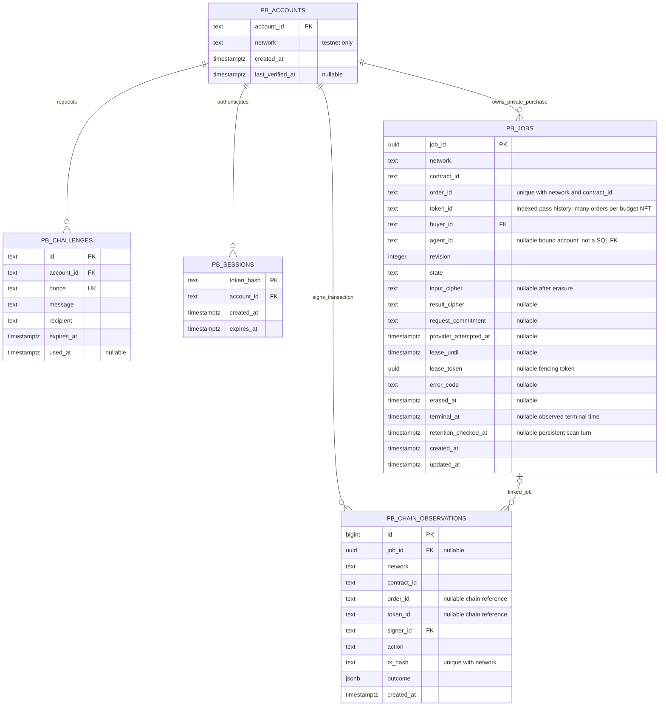
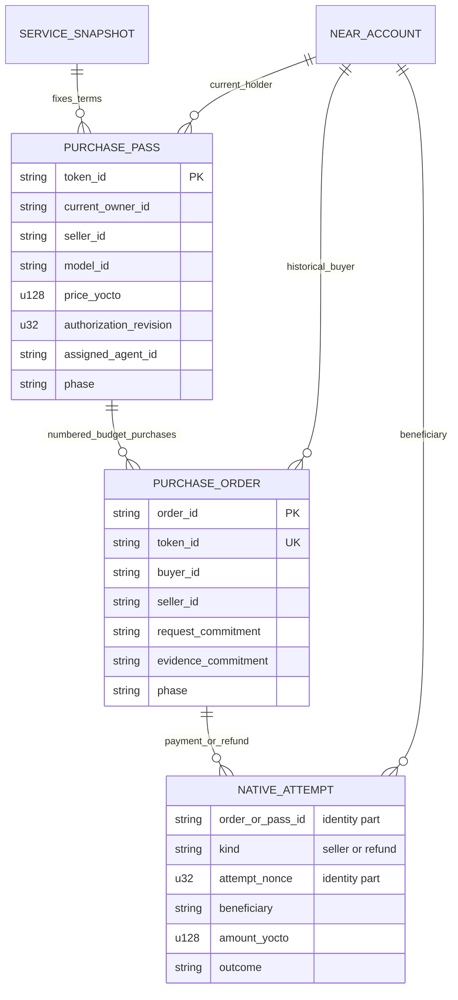

# ProofBill data model and ERD

Schema guide updated 14 November 2026. The relational migration was applied without resetting data; the recorded Neon inspection confirmed five application tables and five foreign keys. The diagram includes the later agent-binding and lease-fencing columns from [the migration](../../packages/server/src/relations.sql). Blockchain references are logical links, not SQL foreign keys.

## 1. Initial Neon schema: historical snapshot before the migration

The first `information_schema` inspection found four tables:

| Existing table | Actual primary key | Other actual constraint | Actual foreign keys |
| --- | --- | --- | --- |
| `pb_challenges` | `id` | — | None |
| `pb_sessions` | `token_hash` | — | None |
| `pb_jobs` | `order_id` | `UNIQUE(token_id)` | None |
| `pb_chain_observations` | `id` | — | None |

At that initial point the identifier columns were not enforced foreign keys. The applied relational upgrade now implements the target below; its source is `packages/server/src/relations.sql`.

## 2. Implemented relational model: five Neon tables

Five application tables share a public account identity table, a stable job primary key and optional job links on chain observations. Contract balances are not replicated as authoritative SQL balances.

The first application operates on NEAR testnet only. Account IDs are NEAR public identities, never secrets. `pb_accounts.network` is constrained to `testnet` for this release; the same table must not silently mix mainnet accounts later. Supporting both networks requires explicitly scoping account identity and its foreign keys.

`UK` means a unique constraint. Scoped order identity is unique; pass identity is an indexed history relationship. Individual `order_id`, `token_id` or `tx_hash` columns are not globally unique by themselves.

## 3. What each table owns

### `pb_accounts`: common public identity

Primary key: `account_id`, for example a named testnet account or an implicit account. Account records include both users and known operational signers. `last_verified_at` is nullable because seeing a public account in a transaction is not proof that the current browser controls it.

An account row does not grant access. A private session still requires a valid wallet message signature. It contains no seed phrase, private key, wallet balance or authoritative NFT ownership.

### `pb_challenges`: one-time login requests

Primary key: random challenge `id`. Foreign key: `account_id -> pb_accounts.account_id`. `nonce` is unique. Store the exact message and recipient being signed, expiry and whether it was consumed.

One account can request multiple challenges. A challenge can succeed at most once. Expired/used challenges can be cleaned up independently from valid sessions.

### `pb_sessions`: authenticated application access

Primary key: `token_hash`, the SHA-256 hash of an opaque random session token. Foreign key: `account_id -> pb_accounts.account_id`. The raw token is carried in a secure HTTP-only cookie, not stored in the database.

One account can have multiple sessions. Session identity is fixed; switching browser wallets does not rewrite an existing session's account. A successful challenge creates a session through application logic; there is intentionally no persistent session-to-challenge FK because challenges are short-lived disposable authentication material.

### `pb_jobs`: one private purchase execution

Primary key: internal `job_id` UUID. Foreign key: `buyer_id -> pb_accounts.account_id`. This buyer binding is immutable once reserved/execution has started. An unreserved, unattempted stale request can be rebound only through the guarded fresh-task path after an ownership/revision change; a new holder's request never reuses the former holder's private input.

External order identity `(network, contract_id, order_id)` is unique. Version 3 replaces the permanent per-pass uniqueness index with `pb_jobs_pass_history(network, contract_id, token_id, created_at)`: a budget NFT has several numbered orders, while the contract permits only one active order. Legacy IDs remain `pass-N-order`; budget IDs are `pass-N-order-K`. The internal UUID stays stable for leases and relations.

The row owns the worker lifecycle, encrypted input/result/evidence bundle, one provider-attempt marker and private retention. A queued row may exist before an onchain reservation, so a SQL row alone never proves an order was created onchain. `revision` snapshots authorization when the task is accepted.

`agent_id` binds the accepted agent but is intentionally not another account FK. External preparation starts in `awaiting_reservation`; finalized reservation validation moves it into the executable queue. `lease_token` fences worker updates and heartbeats to the current claim. Expired active leases are reconsidered on each claim; a provider-attempt marker prevents automatic repeated inference after an unknown outcome.

For this single-execution service, output and verification artifacts are one encrypted payload in `result_cipher`. Separate request, artifact and verification-history tables are not needed until the product actually supports multiple deliveries/versions. The exact-byte evidence remains lossless inside that encrypted bundle.

After permitted erasure, clear ciphertext and record `erased_at`; retain the job's non-secret identity and payment references. The worker records the first confirmed terminal observation in `terminal_at` and erases private payloads seven days later. Buyer-requested erasure requires a terminal order. Neither path deletes public chain history.

Retention batches persist `retention_checked_at` before chain reads and rotate by the oldest check/creation time. Unresolved jobs and individual RPC failures cannot monopolize the first twenty rows across worker restarts. The scan index and erasure are scoped to the configured testnet contract. See [the regression checks](../evidence/retention-fairness.md).

### `pb_chain_observations`: observed transaction evidence

Primary key: bigint `id`. Foreign keys: optional `job_id -> pb_jobs.job_id`, and `signer_id -> pb_accounts.account_id`. `UNIQUE(network, tx_hash)` stores one transaction envelope once for this one-call-per-transaction MVP. The receipt/callback tree remains in `outcome` rather than being counted as several payments.

`job_id` can be null for minting a pass, transferring it before an order, or observing a transaction that did not originate from a local job. The separate `order_id`/`token_id` fields preserve public chain references even when no local job exists. A matching local job is linked only after network/contract/order identity agrees.

Many transactions can belong to one job: reservation, delivery publication, Manual payment approval and an explicit failed-payment retry. In Automatic mode the initial payout starts from delivery publication; there is no final buyer-approval transaction. One observation links to at most one local job in the MVP. If future batches affect multiple independent jobs, introduce a transaction-job junction.

This table is a record of RPC evidence. Editing it cannot authorize a seller payout or change a pass owner. Actual receiver outcomes and contract state remain authoritative.

## 4. Keys and cardinality

| Child column | Parent key | Cardinality | Optional? | Meaning |
| --- | --- | --- | --- | --- |
| `pb_challenges.account_id` | `pb_accounts.account_id` | Account 1 -> 0..N challenges | No | Account for the login challenge |
| `pb_sessions.account_id` | `pb_accounts.account_id` | Account 1 -> 0..N sessions | No | Verified principal of a session |
| `pb_jobs.buyer_id` | `pb_accounts.account_id` | Account 1 -> 0..N jobs | No | Historical buyer allowed to read private data |
| `pb_chain_observations.signer_id` | `pb_accounts.account_id` | Account 1 -> 0..N observations | No | Actual transaction signer |
| `pb_chain_observations.job_id` | `pb_jobs.job_id` | Job 0..1 per observation; 0..N observations per job | Yes | Local job associated with the observed transaction |

An account can be buyer in one context and signer/agent in another; do not encode a single global role that silently grants contract permissions.

## 5. Constraints and indexes

- Account network is explicitly testnet in this first release; validate public account ID format.
- `UNIQUE(pb_challenges.nonce)` and challenge consume update guarded by `used_at IS NULL` and server expiry.
- `UNIQUE(pb_jobs.network, contract_id, order_id)` for external order identity.
- A non-unique scoped pass-history index; unique order identity plus contract reservation enforces each numbered purchase. Preparation locks the pass's SQL task rows before chain validation.
- `UNIQUE(pb_chain_observations.network, tx_hash)` for one saved envelope per transaction.
- If an observation has `job_id`, its network/contract/order association must match that job. Enforce the identity check in the writer; a simple UUID FK alone does not prove this equality. Use a composite FK including scope fields if a second independent writer is introduced.
- Job revision is nonnegative; allowed worker states are explicit rather than arbitrary caller strings. Unknown provider execution is not automatically retried.
- An erased job has null ciphertext and a non-null erasure timestamp. It must not be selected for another inference attempt.
- FK deletion behavior is RESTRICT for accounts and job-linked financial history. Expired auth rows are removed directly; private erasure clears payload columns without cascading away history. Operator-level account/job deletion is outside the product flow.
- Index challenge/session expiry for cleanup, session account ID for logout/review, buyer+created time for purchase history, job state+created time for queue leasing, observation job ID, and observation contract+token ID for pass history.

The applied migration backfills identities/job UUIDs before adding constraints. API and worker writers now use the same scope and keys. A future migration must preserve that ordering and existing data.

## 6. Contract state: separate from Neon tables

These are logical entities persisted in the Rust contract, not SQL tables or cross-database FK targets:

The attempt entity describes the financial identity/invariant. The initial implementation may persist its nonce and state within pass/order records rather than as a separate iterable collection. A diagram entity does not imply a separate implemented map.

A legacy pass has at most one order; a budget pass retains a sequence of orders with at most one active. Each order can have explicit retries after proven failure but only one successful seller payment. The contract's budget sidecar tracks funded, available, reserved, spent and refunded amounts with exact conservation. Transfer between orders moves the remaining allocation; it never rewrites earlier buyers or their private artifacts. Budget/policy sidecars preserve existing Borsh record layouts.

## 7. Joining the two layers

| Reference | Type of relationship | Authority |
| --- | --- | --- |
| Job `network/contract_id/token_id` -> onchain pass | Logical chain reference, not SQL FK | Fresh contract read |
| Job `network/contract_id/order_id` -> onchain order | Logical chain reference, not SQL FK | Confirmed reservation/order state |
| Account `account_id` -> public NEAR identity | Public identifier; control proved by signature | Signature + account key verification |
| Observation `tx_hash` -> transaction/receipt tree | Public chain reference | RPC evidence/final receiver outcome |
| NFT's current owner -> private result access | Not an access relationship | Historical order buyer/session controls private read |

Neon cannot enforce a foreign key against a blockchain map. The app reads the correct network and contract, verifies identifiers and commitments, and stores an observational link. A SQL `state='delivered'` or a recorded transaction hash cannot make a contract payment succeed.

## 8. Concrete Manual example

1. Alice requests a challenge and establishes a session. Both rows point to Alice's account record.
2. Alice mints `pass-1`; mint observation has no `job_id` because no order exists yet.
3. Alice transfers the unused pass to Bob. The contract changes ownership and invalidates the prior agent assignment; the transfer observation still has no local job.
4. Bob authenticates, assigns an agent, and submits a private brief. A job with its own UUID points to Bob as immutable buyer and to the scoped pass/order IDs.
5. The agent's reservation and publisher's delivery transactions link to that job; their respective signer account IDs are retained.
6. Bob approves payment. Its observation links to the job. Paid/Completed is displayed only after the contract's final transfer result agrees.
7. A future transfer of the Completed NFT does not rewrite `pb_jobs.buyer_id`; private results remain Bob's until exported/erased under the retention policy.

## 9. Relational migration history

1. Add/backfill `pb_accounts` from public account identifier columns without treating those rows as authenticated sessions.
2. Add job UUID and explicit network/contract scope; preserve existing order IDs and data.
3. Add optional job linkage, scope and transaction deduplication to observations.
4. Add the FKs, uniqueness and lifecycle constraints after checking existing rows.
5. Adapt auth/API/worker queries and atomic leases to the new keys in the same implementation slice.

The review itself did not change the database. After authorization, the implementation applied the relational migration without a data reset or DROP TABLE. Worker retention records the first confirmed terminal observation in `terminal_at`, then erases active private payloads after seven days.
