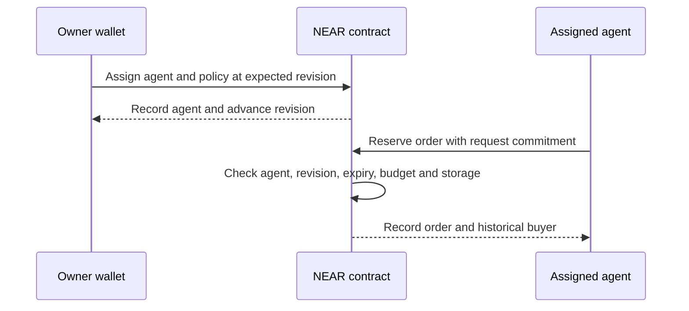

# Authorize an Agent

The pass holder selects the hosted ProofBill assistant or an external agent’s NEAR account. The owner signs authorization; the NFT stays in the owner’s wallet. The agent later signs reservations from its own account.

## Why funding and assignment are separate

Minting deposits funds and records the pass policy. Assignment identifies the account allowed to use that permission. The current assignment form also permits policy edits, so it displays the existing Manual/Automatic choice again. It starts with the saved mode; choosing a different mode is not required. Automatic consent is explicitly confirmed for the authorization being saved.

Settings advance the authorization revision. A request prepared against an old owner, agent, or revision must not silently execute under new permission. Execution rechecks these identities before using saved private input.

The agent cannot redirect the seller payment or sign as the owner. Active orders lock transfer and policy changes. A transfer between orders clears assignment and Automatic authority, so the new holder authorizes their own agent.
