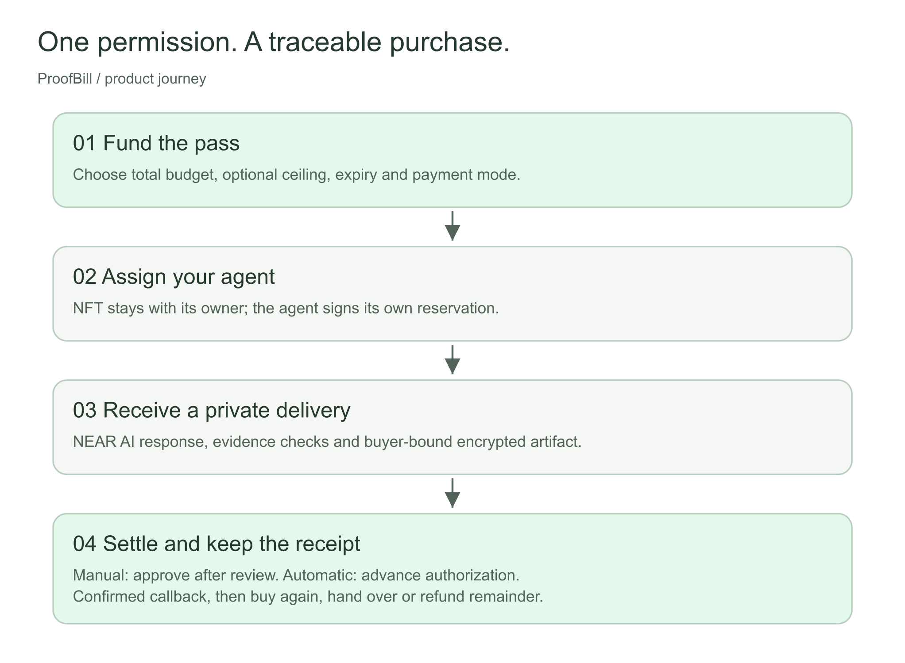
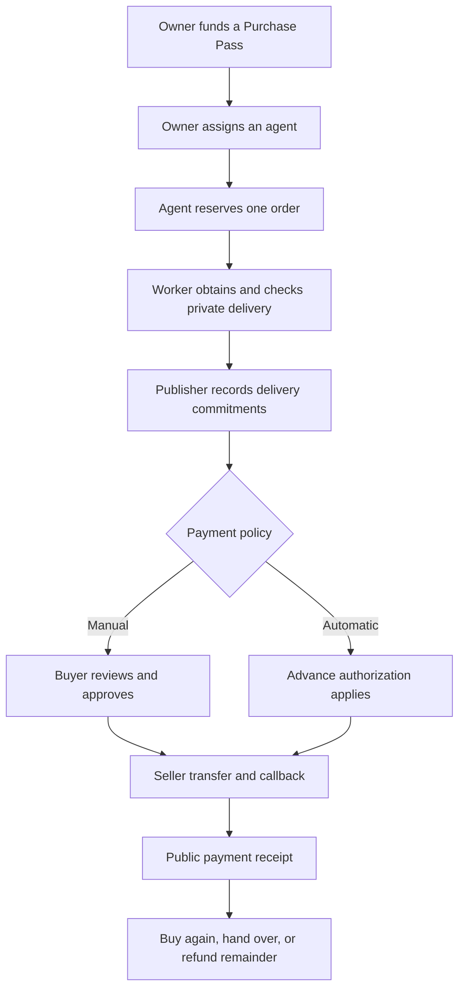

# Overview

The owner funds a pass and assigns an agent. The agent reserves one service allocation, the worker obtains and checks a response, and the publisher records delivery commitments. Manual approval or the Automatic policy starts settlement. A successful transfer callback establishes payment.

*Product journey. The two payment paths converge on confirmed settlement.*

| Stage | What changes |
| --- | --- |
| [Funding](funding.md) | A service allocation and separately backed NFT are created |
| [Agent authorization](agent-authorization.md) | One agent and a fresh revision are recorded |
| [Private delivery](private-delivery.md) | Request, response, and evidence link to one order |
| [Settlement](settlement.md) | The seller transfer succeeds or keeps an unresolved/failure state |
| [Refund and handover](refund-and-handover.md) | Remaining rights close or move without rewriting previous buyers |
