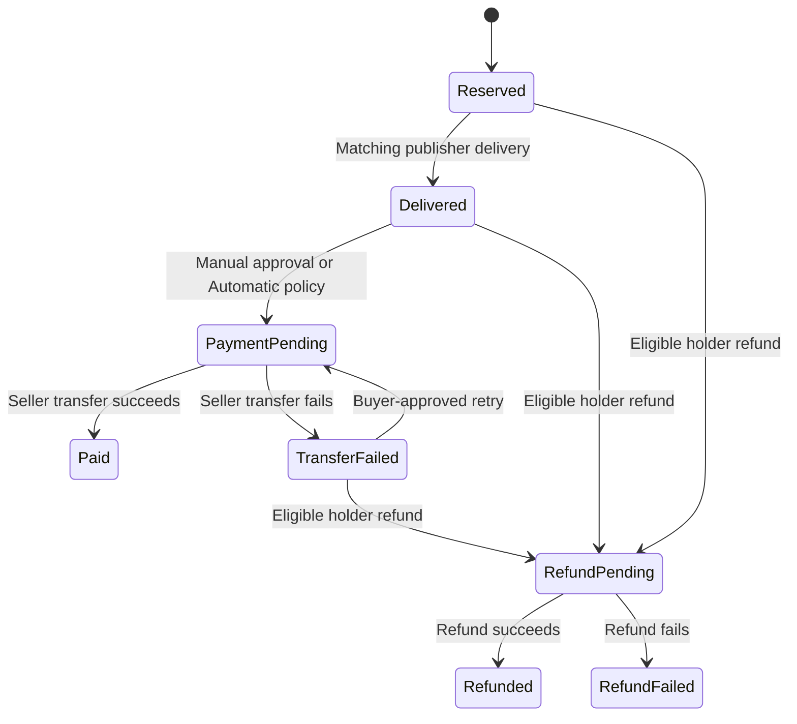

# Settle the Payment

Payment policy determines when the owner authorizes the initial seller payment. Both policies require a successful transfer callback.

| Policy | Initial authorization | Delivery behavior |
| --- | --- | --- |
| Manual | Buyer approves the delivered order | Buyer can inspect the result before payment |
| Automatic | Holder explicitly authorizes the pass in advance | Matching publisher delivery starts payment without final approval |

Automatic trusts the publisher’s matching-delivery assertion. A compromised publisher can trigger a preauthorized payment; evidence does not guarantee semantic quality. Manual approval checks the delivered commitment and requires an unexpired pass.

Paid moves the reserved allocation into spent funds. A reusable pass returns to Available if service value remains, with a new revision. Expiry, quote, optional ceiling, and storage requirements still apply to the next order.

Failed-payment retries require buyer approval in either policy. Pending outcomes must be checked before another action. A transaction hash alone is not a payment confirmation.
