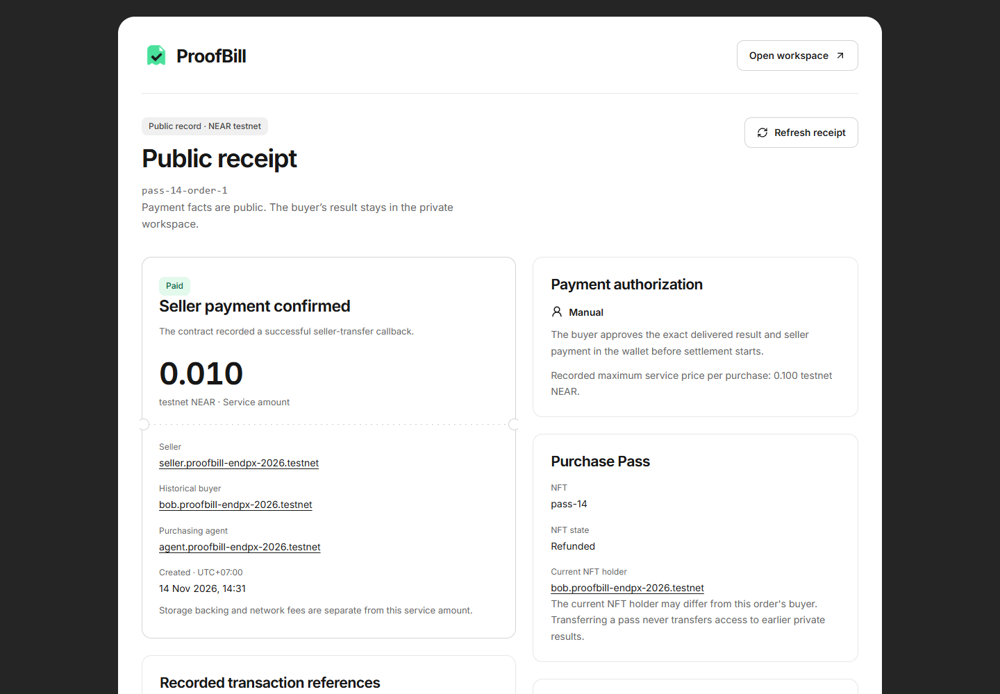

# Overview

ProofBill is a purchasing workspace for people who use agents to call paid AI services. An owner funds a reusable NFT Purchase Pass, assigns an agent, receives a buyer-private result, and chooses how the seller gets paid. Public receipts connect permission to confirmed payment without publishing the brief or answer.

Built with **NEAR Protocol on testnet**, **NEAR AI Cloud**, and **NEP-171 NFTs**, the application demonstrates one service: extracting an item, quantity, and requester from a purchase brief. It pays for extraction; it does not buy the physical items mentioned in the brief.

## One budget, repeated purchases

| Owner decides | What it controls |
| --- | --- |
| Total service budget | Funds available across repeated purchases |
| Optional purchase limit | An additional ceiling on one seller payment |
| Agent and expiry | Who may reserve an order, and when permission ends |
| Manual or Automatic | Review each delivery or authorize payment in advance |

One order can be active at a time. The NFT stays with the owner while the assigned agent signs its own reservations. A wallet-message signature opens the private workspace; anyone can inspect a public receipt without a wallet.

*Recorded testnet receipt for pass-14-order-1. Private delivery bytes are not displayed.*

This is an unaudited testnet MVP. The operator handles plaintext during execution, the contract trusts its publisher, and a FullAccess administrator can move funds or replace code. See [Authorization and Trust Boundaries](../technical/authorization.md). Independent customer validation has not yet been completed.
