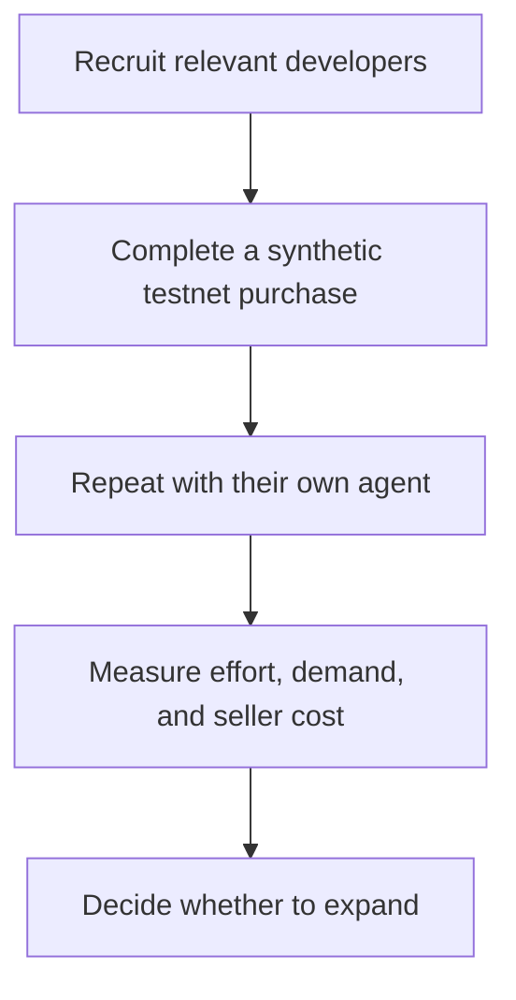

# Roadmap

The current milestone is a hosted testnet MVP with recorded purchases, payments, handover tests, and refunds. Runs use project-controlled or builder accounts and synthetic briefs. They are not independent customer validation.

| Phase | Work | Decision gate |
| --- | --- | --- |
| Independent trial | Invite five developers already running paid-API agents | Learn whether controls justify wallet/storage setup |
| Repeat use | Assign an external agent, complete two purchases, then refund or hand over | Proposed early signal: three unaided completions and two requests to return |
| Seller economics | Compare inference cost, rejected Manual deliveries, paid work, and support | Establish whether providers can sustain the policy |
| Service expansion | Evaluate more services and independently quoted prices | Expand only when demand and authorization rules are clear |
| Mainnet assessment | Review administration, custody, security testing, and audit needs | A separate readiness decision |

## Go-to-market

The initial customer hypothesis is a small team that already pays for agent API calls. Founder-led outreach in NEAR Builders and open-source agent communities can recruit focused trials using synthetic data. Activation means completing a purchase, understanding a receipt, and choosing how to handle the remainder—not merely connecting a wallet.

Ask whether users return without help and whether NFT handover improves their existing budget workflow. Publish feedback only with consent. No outreach, partnerships, conversion rate, or revenue is claimed here.

## Commercial model

The demo charges no platform fee. A hosted team subscription or disclosed service fee remains a hypothesis. Pricing must account for repeat use, inference cost, support, and Manual deliveries that a buyer refuses to pay for.

