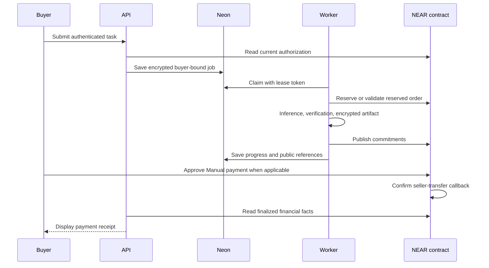

# Data Flow and Indexing

The workspace combines finalized contract reads with authenticated job progress. Balances come from the contract. Jobs supply private tasks/results and worker status. Observations supply useful public transaction references without becoming another financial ledger.

## Observation is not authorization

`pb_chain_observations` contains application-observed references. It is not an exhaustive general-purpose chain indexer. Missing reference persistence does not invalidate an otherwise readable confirmed order; a saved transaction hash does not prove a successful receiver outcome.

Public receipts read the order and current NFT holder at one finalized block. Database reference queries select public columns only, without loading private payloads or session identity. Pending and failed states remain distinct.
