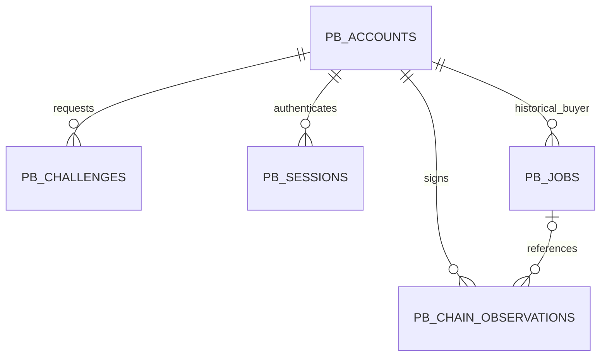
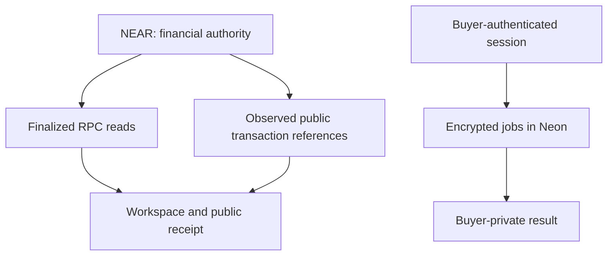

# Onchain and Offchain Data

## Authoritative onchain state

| Record | Contents | Authority |
| --- | --- | --- |
| NFT/pass | Owner, agent, revision, expiry, service, seller | Contract |
| Budget/policy sidecars | Allocations, payment mode, optional ceiling | Contract |
| Order | Historical buyer, agent, amount, commitments, outcome | Contract and successful callbacks |
| Storage credit | Backing charged/released as retained state changes | Contract storage accounting |

Briefs, answers, salts, raw provider evidence, and session secrets are not public order fields.

## Offchain application records: Neon PostgreSQL

| Table | Primary key | Foreign keys | Purpose |
| --- | --- | --- | --- |
| `pb_accounts` | `account_id` | Parent identity | Public testnet accounts, not proof of control |
| `pb_challenges` | `id` | `account_id` → accounts | One-time message, nonce, expiry |
| `pb_sessions` | `token_hash` | `account_id` → accounts | Hashed opaque session and expiry |
| `pb_jobs` | `job_id` UUID | `buyer_id` → accounts | Encrypted input/result, lease, revision, retention |
| `pb_chain_observations` | `id` bigint | `signer_id` → accounts; optional `job_id` → jobs | Observed public action/hash references |

Order identity is unique across `(network, contract_id, order_id)`. A pass has many job-history rows; the contract enforces one active order. `agent_id` is a bound public value, not another SQL FK. SQL references to the blockchain are logical references, not enforceable SQL foreign keys.

## Observational history

The observations table deduplicates transactions within the network and optionally links them to jobs. It contains neither authoritative wallet balances nor replacement NFT ownership.

See the [schema and ERD](https://github.com/EndPx/proofbill/blob/main/docs/database/ERD.md) for exact constraints and [Privacy and Retention](privacy-and-retention.md) for artifact lifetime.
