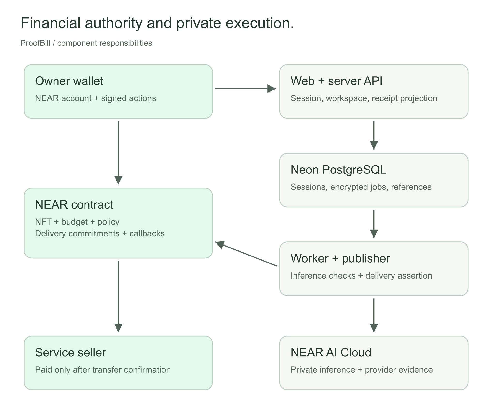
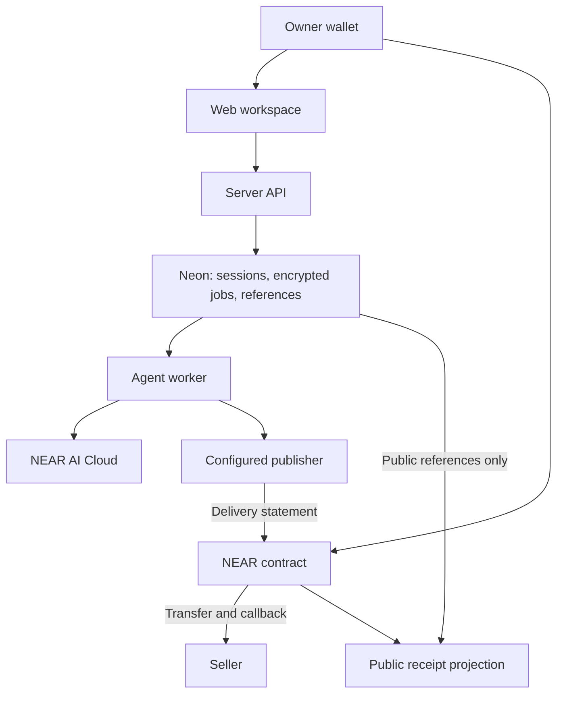

# Overview

Contract state authorizes financial changes. The worker processes private requests; the API authenticates reads and assembles the workspace. Public receipts deliberately expose only confirmed chain facts and public references.

*The publisher asserts delivery. The contract does not verify TEE evidence onchain.*

| Component | Responsibility | Detail |
| --- | --- | --- |
| Web and server API | Wallet entry, session, workspace, receipts | [API and Application Data](api-and-data.md) |
| Rust contract | NFT ownership, authorization, budgets, callbacks | [Smart Contract](smart-contract.md) |
| Worker and Python verifier | Queue, inference checks, artifacts, recovery | [Worker and Recovery](worker.md) |
| Neon PostgreSQL | Sessions, encrypted jobs, observed references | [Onchain and Offchain Data](data-storage.md) |
| Buyer-run verifier | Recheck an exported delivery independently | [Verification](verification.md) |

[Data storage](data-storage.md) separates authoritative records from application rows and observations. [Authorization and Trust Boundaries](authorization.md) explains administrator, publisher, and operator authority before evaluating readiness.
