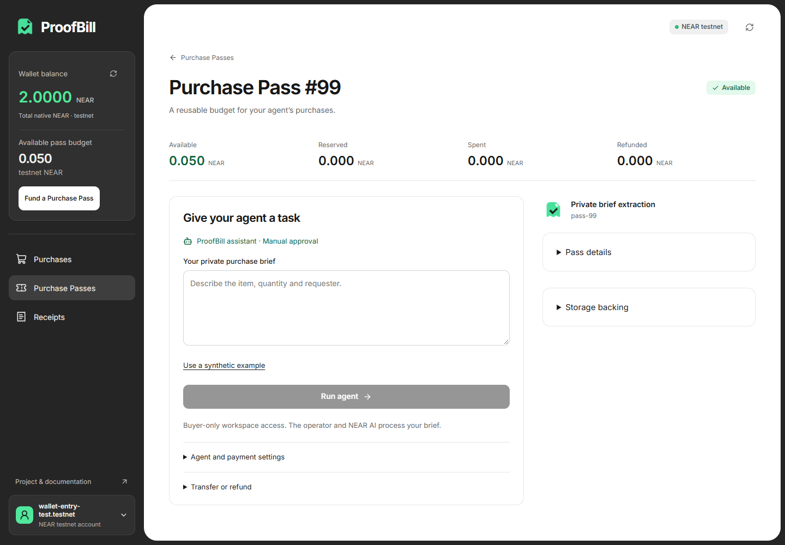

# For Budget Owners

## 1. Create a funded pass

Choose New Purchase Pass. Enter a budget, optionally enable a purchase ceiling, and select ten minutes, 24 hours, three days, or seven days. Choose Manual or explicitly consent to Automatic. Inspect storage and administrator trust before selecting Create and fund pass and confirming the transaction.

## 2. Assign an agent

Open the pass. Choose ProofBill assistant or My own agent. The form carries the saved payment mode and allows changes. Save the intended authorization and confirm the owner transaction. Changing agent or policy invalidates prior authorization.

## 3. Give the agent a synthetic brief

For the hosted assistant, enter “Order 12 notebooks for Maya.” Run agent requests extraction; it does not buy notebooks from a shop. The order updates from recorded progress.

*Local UI fixture using a synthetic account and brief; not a new live wallet transaction.*

## 4. Inspect delivery

Result shows item, quantity, and requester. Details contains order facts; Evidence contains checks and their scope. The historical buyer can export the private evidence. Keep that file private.

## 5. Settle and manage the remainder

For Manual, review the seller/amount and select Approve payment. Automatic uses advance permission after matching publisher delivery, without a final approval. Wait for confirmation.

Open the public receipt. Manage remaining budget lets you buy again, transfer an available pass, or request a service refund that closes the budget. Prior payments and retained storage are excluded from that refund.
