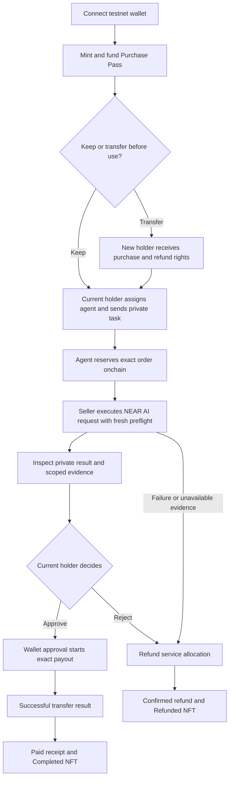

# ProofBill product specification

Status: selected build plan, 13 November 2026. No product functionality is implemented by this document.

## 1. Product and customer

ProofBill gives a developer or small team a controlled way to let an AI agent purchase a service: the spending right lives in an NFT Purchase Pass, the delivered response carries inspectable evidence, and the exact approved order produces one reconciled payment receipt.

First customer: someone already comfortable connecting a NEAR testnet wallet who runs a purchasing agent. The first service is **private purchase-request extraction**: turn a short user-supplied brief into structured item, quantity and requester fields. The demo uses synthetic data. Result quality is reviewed by the buyer.

Problem hypothesis: spending permission, delivered bytes and payment status are often reviewed separately. The owner needs to know what was allowed, what arrived, and whether that exact order was paid. Demand and willingness to pay are not validated yet; there are no claimed customers or measured savings.

## 2. Required scope

| Capability | Product behavior |
| --- | --- |
| Wallet/session | Connect a testnet wallet, authenticate private requests, show the active account/network |
| Purchase Pass | Mint and fund a real NEP-171 NFT for one fixed-price service purchase |
| Transfer | Transfer an unused pass and its remaining service/refund entitlement to another holder |
| Purchasing agent | An explicitly assigned hosted or owner-operated agent account reserves an order within the pass rules |
| Private AI result | Call the supported NEAR AI model, retain exact evidence and keep input/output access-controlled |
| Review | Show result, scoped evidence and exact proposed seller/amount before owner approval |
| Payment | Contract-enforced payout, final-outcome confirmation and duplicate-payment refusal |
| Receipt | Link the pass, order, evidence commitment, approval and actual payment outcome |
| Exit | Refund an unused/cancelled/expired purchase entitlement without losing ownership accounting |

One seller, one service version, one canonical model and native testnet NEAR are sufficient. The initial service uses `Qwen/Qwen3.8-27B`, subject to a live availability check before the integration slice. The earlier probe establishes one response's provenance, not structured-extraction quality.

## 3. Locked product decisions

| Question | Decision for this build |
| --- | --- |
| What does one NFT buy? | One service purchase/order. No subscription or renewable balance. |
| How much is funded? | Exactly the fixed service quote. Storage and network gas are separate. A 0.010 testnet NEAR quote is an illustrative starting demo configuration. |
| Who holds the service budget? | One ProofBill contract, with isolated per-pass liabilities. The NFT carries the right to use/refund its allocation. |
| What follows an unused transfer? | The entire unspent service allocation and its refund right follow the new token owner. The previous funder has no residual claim on it. This is shown before transfer confirmation. |
| Can payment settle automatically? | Manual is the default. The owner can explicitly authorize Automatic settlement for one pass after matching publisher delivery; the agent cannot enable this policy or change the seller/amount. |
| What is immutable in a pass? | Service version, seller, quoted amount, model policy and absolute expiry, snapshotted at mint. |
| When can it transfer? | Unused/unexpired with no reservation, or terminal with zero financial claim. Active orders, native payouts/refunds and unresolved transfer-calls lock transfer. |
| What changes on transfer? | Current holder and authorization revision. Prior agent/task delegations and unused Automatic payment permission are invalidated. |
| What happens after use? | The NFT remains as a Completed pass referencing the receipt; it has no remaining purchase value. |
| Does transfer give private history? | No. Prior private inputs/results remain available only to the historical buyer session. Token ownership conveys public pass state, not past plaintext. |
| Can rejection run another inference? | No. Cancellation/rejection ends this one-order entitlement through refund. A new purchase needs a new pass. Re-verifying saved evidence does not run inference again. |
| What is the platform fee? | Zero for the hackathon flow. Seller service price and provider usage cost are different. |
| Where does it run? | Financial/NFT state on NEAR testnet; actual inference on NEAR AI Cloud. |

No token-linked subaccount is required. The pass's capability is enforced in the contract that also tracks ownership and money. This is an application design using NEP-171, not a claim that the NFT standard automatically provides spending authority.

## 4. Roles

- **Holder/buyer:** owns the purchase/refund right; assigns an agent; supplies private input; reviews and authorizes payment.
- **Purchasing agent:** submits one bounded service order after receiving the holder's task; has no key to the holder's wallet and cannot change the seller or price.
- **Seller/operator:** performs the configured service using its inference credits; receives the approved service payment.
- **Application verifier/publisher:** checks evidence offchain and publishes a scoped result commitment to the contract using a restricted operational account. This role is trusted to report honestly in the MVP.
- **Contract:** authoritative for NFT ownership, pass rules, order identity, escrow allocation, transfer/refund rights and payout state.

The first seller/operator may be run by the project. Label it accordingly; do not imply an independent multi-seller market or external customer activity.

## 5. Primary journey

### A. Connect and create a pass

The user connects a testnet wallet and signs a login challenge for private features. Public product information remains browsable. They open **New Purchase Pass**, inspect service, seller, quote, supported model, expiry and storage cost, then confirm mint/funding in their wallet.

The pass becomes Available only after its transaction is confirmed. Wallet cancellation leaves an actionable draft. The interface shows the contract-held allocation separately from wallet balance and remaining inference credits.

### B. Optional: give the pass to another holder

Before use, the holder can transfer it to a second account. The confirmation says that the unused service/refund entitlement moves with the token. After confirmation the receiver can use/refund it and the previous holder cannot. The receiver assigns its own agent; an old agent assignment is not inherited.

### C. Give the agent a task

The holder selects **Research assistant** or **My own agent**, assigns the chosen testnet account, and chooses Manual or explicitly consents to Automatic payment. Hosted task submission uses a holder session. An external agent authenticates its own account, prepares the buyer-bound request, signs the reservation and submits it through the [own-agent protocol](../agent-integration.md). The NFT remains with the holder.

The worker checks the assignment and submits a real reservation transaction as the agent. Only after that reservation is confirmed does service execution begin. The interface shows **Agent ordering** then **Running** from actual job/chain evidence. This is a bounded purchasing agent, not a claim of a general autonomous business.

### D. Execute and inspect

The seller obtains fresh preflight evidence, makes one non-streaming inference call, retains exact request/response bytes and retrieves the signature. The signed request includes unique order context so an older response cannot be silently relabelled as a new job.

The app presents the extracted result and separate checks: response bytes, model signer, hardware preflight and checks not performed. Required evidence must pass before the publisher records a payment-ready delivery. The publisher statement is an offchain verifier assertion; the NEAR contract does not verify Intel/NVIDIA quotes itself.

### E. Holder approves the exact payment

The buyer sees pass/order IDs, result, seller, exact native testnet amount and evidence scope. **Approve payment** opens the wallet for the bound order and result commitment. It is one owner action that both authorizes and starts the payout; there is no ambiguous second approval queue.

The contract enters Payout pending first. It marks Paid only when the native transfer result succeeds through its callback. A refresh reconnects to the same order. Unknown outcomes remain pending/reconciliation-required rather than causing another transfer.

In Automatic mode, the owner's prior per-pass authorization starts the fixed seller payment when matching publisher delivery is recorded. There is no final owner approval transaction or semantic-review gate. Failed payout, expiry and callback safeguards still apply; the configured publisher remains a disclosed trust boundary.

### F. Receipt and Completed pass

After confirmed payment, show the receipt, seller payment reference, historical approving buyer, commitments and evidence summary. The pass becomes Completed, its service allocation is zero, and its metadata reflects the terminal state. The buyer may download/reverify private evidence explicitly; a public receipt link excludes private content.

## 6. Manual payment journey (default)

Failure/unavailable branches expose a refund action; a browser error does not itself initiate or confirm an onchain refund. Unused expiry also exposes refund. Detailed state transitions live in the technical design.

## 7. Money and NFT rights

Service allocations are contract liabilities. Storage backing, operational gas and any unused storage credit are separate from seller money. Do not treat the contract's gross account balance as spendable purchase funds.

The current owner can request a refund before payment starts. That request snapshots the beneficiary and locks the pass until the refund succeeds or has a proven failure. After an order is reserved, ownership is locked and the recorded buyer remains the refund beneficiary. Funds never silently return to a former owner after an unused pass transfer.

If a seller payment fails conclusively, allow an explicit retry of that same payment or a refund exit; the contract serializes these alternatives. If the outcome is unknown, neither a new seller payout nor refund is allowed until reconciled. Pass expiry does not undo a payment already approved and in flight.

One inference request consumes the seller's credits even if the buyer rejects payment. This MVP demonstrates buyer-controlled purchasing, not guaranteed seller payment for every delivered result. The seller accepts that bounded risk; the service has input limits, one request per pass and operating rate limits. Pricing/fairness validation belongs after the functional demo.

## 8. Privacy experience

- Login uses wallet message-signing with a short-lived, single-use server challenge, recipient/domain and network binding.
- Private task/result endpoints require an authenticated historical buyer and fresh order authorization. A public wallet address or NFT ID alone is not authentication.
- Input, exact provider bodies, evidence and private result are encrypted at rest; keys remain server-only. No plaintext request bodies appear in ordinary logs or analytics.
- Onchain state includes public identities, amounts, timing and salted, domain-separated commitments. It does not contain prompt, output or credential values.
- A transferred unused pass receives no old private draft; the new holder supplies a fresh task. Private artifacts from completed orders stay with that order's buyer even when the zero-value NFT transfers later.
- Default retention is seven days from terminal order state for private payloads, configurable and shown before use. Buyer may explicitly export before expiry or erase payloads; public chain records remain. Erasure during an active order first requires cancellation/settlement, so evidence is not silently lost mid-payout.
- The web app/worker/verifier handles plaintext to deliver this version. Disclose that trust boundary. Do not describe the app as end-to-end encrypted, zero-knowledge, operator-blind, or fully anonymous.

## 9. Screens and design

Continue the selected [v2 visual direction](../../design/proofbill-ui-v2/README.md): dark outer frame/sidebar, one white inset surface with rounded corners, black primary actions, mint/amber for small meaningful states. No redesign cycle before the end-to-end path works.

| Screen | Essential content/action |
| --- | --- |
| Public intro | Problem, short product flow, four demonstrated capabilities, Open app |
| Purchases | Available/reserved/paid service amounts, active orders, next action, link to their pass |
| Purchase Passes | Available/In use/Completed/Refunded NFTs; New pass; current owner and entitlement |
| New Purchase Pass | Service quote, seller/model, expiry, separate funding/storage confirmation |
| Pass detail | NFT identity, current holder, allocation, assignment, transfer before use, refund and history |
| New task | Private brief and sample input; selected agent/pass; Run agent |
| Order detail | Result/Request/Evidence tabs; payment approval receipt; actual lifecycle timeline |
| Receipt | Public payment facts; authenticated evidence export; explorer links; linked Completed NFT |

Rename the old **Permits** navigation to **Purchase Passes** and **New permit** to **New Purchase Pass**. Keep wallet/account options in the sidebar footer rather than building an extensive Settings module.

Proposed app routes: `/app/purchases`, `/app/passes`, `/app/passes/new`, `/app/passes/[tokenId]`, `/app/orders/[orderId]`, `/app/receipts/[orderId]`. These are planned routes, not existing pages.

## 10. Four-track delivery

| Track | Demonstrated moment |
| --- | --- |
| Agent Economy | Assigned agent reserves a service order; buyer-approved payment reaches the seller |
| AI Security & Defense | Disallowed/old-owner action and repeated payment are refused; amount/payee constraints hold |
| Privacy & Private AI | Actual verified model response; owner-only result; another account is denied; public data excludes plaintext |
| NFTs That Do Something | Real NFT transfers unused purchasing value; new owner can use it; completed metadata reflects actual settlement |

These are required build outcomes for the user's selected scope. Until implemented they remain targets, not submission claims.

## 11. Business and next users

First validation: ask a small number of developers who already operate paid-API agents to inspect a complete purchase receipt and try setting a pass. Record confusion, review time, whether transfer/refund is useful, and willingness to use the workflow again. Do not turn test accounts into traction claims.

After validation, explore a hosted team plan for budgets, approvals and reconciliation, or a disclosed service fee. The hackathon flow takes no platform fee. Later phases may add recurring passes, more sellers, supported mainnet assets, Agent Connect or team treasury integrations. The initial product has no cross-chain, staking, marketplace or autonomous custody dependency.
