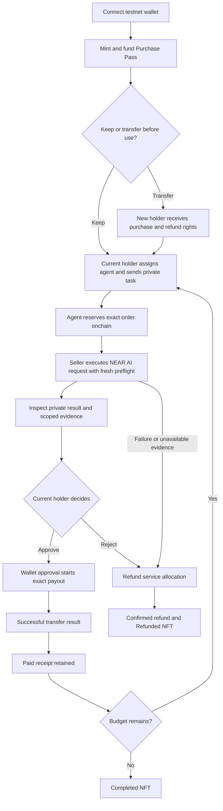

# ProofBill product specification

Product guide aligned with the implemented testnet scope on 14 November 2026. This document explains behavior; [release records](../evidence/agent-payment-hosted.md) and [public-receipt evidence](../evidence/public-receipts.md) establish what was exercised.

## 1. Product and customer

ProofBill gives a developer or small team a controlled way to let an AI agent purchase a service: the spending right lives in an NFT Purchase Pass, the delivered response carries inspectable evidence, and the exact approved order produces one reconciled payment receipt.

First customer: someone already comfortable connecting a NEAR testnet wallet who runs a purchasing agent. The first service is **private brief extraction**: turn a short user-supplied brief into structured item, quantity and requester fields. The demo uses synthetic data. Manual mode lets the buyer review quality before approving; Automatic mode has no final quality-review gate.

Problem hypothesis: spending permission, delivered bytes and payment status are often reviewed separately. The owner needs to know what was allowed, what arrived, and whether that exact order was paid. Demand and willingness to pay are not validated yet; there are no claimed customers or measured savings.

## 2. Required scope

| Capability | Product behavior |
| --- | --- |
| Wallet/session | Connect a testnet wallet, authenticate private requests, show the active account/network |
| Purchase Pass | Mint a real NEP-171 NFT with a chosen budget for repeated fixed-price purchases; legacy single-use passes remain supported |
| Transfer | Transfer an available pass and its remaining service/refund entitlement between orders |
| Purchasing agent | An explicitly assigned hosted or owner-operated agent account reserves an order within the pass rules |
| Private AI result | Call the supported NEAR AI model, retain exact evidence and keep input/output access-controlled |
| Review | Buyer-authenticated result/evidence; Manual permits review before payment, while Automatic has no final review gate |
| Payment | Contract-enforced payout, final-outcome confirmation and duplicate-payment refusal |
| Receipt | Anonymous public pass/order/payment facts and authorization mode; buyer-only private result and evidence |
| Exit | Refund an unused/cancelled/expired purchase entitlement without losing ownership accounting |

The current service uses one seller, one service version, `Qwen/Qwen3.8-27B` and native testnet NEAR. The recorded integration established structured extraction for synthetic examples, not general answer quality or future model availability.

## 3. Locked product decisions

| Question | Decision for this build |
| --- | --- |
| What does one NFT buy? | A custom service budget for sequential purchases at the current 0.010 testnet NEAR quote. No service-budget top-ups or subscriptions. V3/single-use passes remain supported. |
| How much is funded? | Chosen total covering one quote, without price steps or a 1 NEAR ceiling, plus independent initial storage backing of at least 0.030 NEAR and wallet gas. Actual history can require a separate owner-approved storage top-up. |
| Is there a limit per purchase? | Optional positive owner ceiling. Absence adds no separate cap; fixed quote, remaining allocation, assignment and expiry still apply. The limit does not set the merchant price. |
| Who holds the service budget? | One ProofBill contract, with isolated per-pass liabilities. The NFT carries the right to use/refund its allocation. |
| What follows transfer between orders? | The unspent service allocation and refund right follow the new owner. Prior payments stay recorded and prior buyers keep their private history. |
| Can payment settle automatically? | Manual is the default. The owner can explicitly authorize Automatic settlement for one pass after matching publisher delivery; the agent cannot enable this policy or change the seller/amount. |
| What is immutable in a pass? | Service version, seller, quoted amount, model policy and absolute expiry, snapshotted at mint. |
| When can it transfer? | Available/unexpired between orders, or terminal with zero financial claim. Active orders, native payouts/refunds and unresolved transfer-calls lock transfer. |
| What changes on transfer? | Current holder and authorization revision. Between orders, prior agent/task delegations, Automatic permission and the prior holder's per-purchase ceiling are cleared. Earlier order snapshots remain unchanged. |
| What happens after payment? | A budget pass with remaining funds returns to Available; an exhausted pass becomes Completed. Each numbered order keeps its receipt and recorded policy. Successful settlement increments authorization revision. |
| Does transfer give private history? | No. Prior private inputs/results remain available only to the historical buyer session. Token ownership conveys public pass state, not past plaintext. |
| Can rejection run another inference? | No. Cancel/refund closes the pass and returns available/reserved service funds. Paid orders are not refunded. A successful paid order can be followed by a new explicitly identified task using remaining budget. |
| What is the platform fee? | Zero for the hackathon flow. Seller service price and provider usage cost are different. |
| Where does it run? | Financial/NFT state on NEAR testnet; actual inference on NEAR AI Cloud. |

No token-linked subaccount is required. The pass's capability is enforced in the contract that also tracks ownership and money. This is an application design using NEP-171, not a claim that the NFT standard automatically provides spending authority.

## 4. Roles

- **Holder:** current NFT owner; controls unused purchase/refund rights, assignment and payment policy.
- **Buyer:** holder recorded at reservation; retains access to that order's private result even if the Completed NFT later transfers. Manual payment and failed-payment retries require this buyer's approval.
- **Purchasing agent:** submits one bounded service order after receiving the holder's task; has no key to the holder's wallet and cannot change the seller or price.
- **Seller/operator:** performs the configured service using its inference credits; receives the approved service payment.
- **Application verifier/publisher:** checks evidence offchain and publishes a scoped result commitment to the contract using a restricted operational account. This role is trusted to report honestly in the MVP.
- **Contract:** authoritative for NFT ownership, pass rules, order identity, escrow allocation, transfer/refund rights and payout state.

The first seller/operator may be run by the project. Label it accordingly; do not imply an independent multi-seller market or external customer activity.

## 5. Primary journey

### A. Connect and create a pass

The user connects a testnet wallet and signs a login challenge for private features. Public product information remains browsable. They open **New Purchase Pass**, inspect service, seller, quote, supported model, expiry and storage cost, then confirm mint/funding in their wallet.

The pass becomes Available only after its transaction is confirmed. The budget field and funding quote use exact atomic amounts; changing the budget clears Automatic consent. Wallet cancellation leaves an actionable draft. Contract-held service allocation, storage backing, wallet balance and operator inference credits are distinct.

### B. Optional: give the pass to another holder

Before use, the holder can transfer it to a second account. The confirmation says that the unused service/refund entitlement moves with the token. After confirmation the receiver can use/refund it and the previous holder cannot. The receiver assigns its own agent; an old agent assignment is not inherited.

### C. Give the agent a task

The holder selects **ProofBill assistant** or **My own agent**, assigns the chosen testnet account, and chooses Manual or explicitly consents to Automatic payment. Hosted task submission uses a holder session. An external agent authenticates its own account, prepares the buyer-bound request, signs the reservation and submits it through the [own-agent protocol](../agent-integration.md). The NFT remains with the holder.

For the hosted assistant, the worker checks the assignment and signs the reservation. An external agent signs its own reservation; the worker only executes the already-reserved task. Service execution begins after the reservation is confirmed. Job progress and contract state are separate. This is a bounded purchasing agent, not a general autonomous business.

### D. Execute and inspect

The seller obtains fresh preflight evidence, makes one non-streaming inference call, retains exact request/response bytes and retrieves the signature. The signed request includes unique order context so an older response cannot be silently relabelled as a new job.

The app presents the extracted result and separate checks: response bytes, model signer, hardware preflight and checks not performed. Required evidence must pass before the publisher records a payment-ready delivery. The publisher statement is an offchain verifier assertion; the NEAR contract does not verify Intel/NVIDIA quotes itself.

### E. Payment follows the owner's chosen policy

In Manual mode, the buyer sees pass/order IDs, result, seller, exact native testnet amount and evidence scope. **Approve payment** opens the wallet for the bound order and result commitment. This action both authorizes and starts the payout; there is no second approval queue.

The contract enters PaymentPending (shown as Payment pending) first. It marks Paid only when the native transfer result succeeds through its callback. A refresh reconnects to the same order. Unknown outcomes remain pending/reconciliation-required rather than causing another transfer.

In Automatic mode, the owner's prior per-pass authorization starts the fixed seller payment when matching publisher delivery is recorded. There is no final owner approval transaction or semantic-review gate. Failed payout, expiry and callback safeguards still apply; the configured publisher remains a disclosed trust boundary.

### F. Receipt and Completed pass

After confirmed payment, the public receipt shows that order's historical buyer, current holder, recorded authorization mode and commitments/references. Remaining budget reopens the pass as Available; zero remaining budget makes it Completed. Another task needs the new order ID/revision. Earlier receipts and private buyer access remain unchanged. The buyer can export and [verify private evidence](../verify-private-result.md); the public receipt excludes it.

## 6. Manual payment journey (default)

Failure/unavailable branches expose a refund action; a browser error does not itself initiate or confirm an onchain refund. Unused expiry also exposes refund. Detailed state transitions live in the technical design.

## 7. Money and NFT rights

Service allocations are contract liabilities. Storage backing, operational gas and any unused storage credit are separate from seller money. Do not treat the contract's gross account balance as spendable purchase funds.

The current owner can request a refund before payment starts. That request snapshots the beneficiary and locks the pass until the refund succeeds or has a proven failure. After an order is reserved, ownership is locked and the recorded buyer remains the refund beneficiary. Funds never silently return to a former owner after an unused pass transfer.

If a seller payment fails conclusively, allow an explicit retry of that same payment or a refund exit; the contract serializes these alternatives. If the outcome is unknown, neither a new seller payout nor refund is allowed until reconciled. Pass expiry does not undo a payment already approved and in flight.

One inference request consumes the seller's credits even if the buyer rejects payment. This MVP demonstrates buyer-controlled purchasing, not guaranteed seller payment for every delivered result. The seller accepts that bounded risk; the service has input limits, one request per pass and operating rate limits. Pricing/fairness validation belongs after the functional demo.

## 8. Privacy experience

- Login uses wallet message-signing with a short-lived, single-use server challenge, recipient/domain and network binding.
- Private task/result endpoints require an authenticated historical buyer and fresh order authorization. A public wallet address or NFT ID alone is not authentication.
- Input, exact provider bodies, evidence and private result are encrypted at rest; keys remain server-only. No plaintext request bodies appear in ordinary logs or analytics.
- Onchain state includes public identities, amounts, timing and salted, domain-separated commitments. It does not contain prompt, output or credential values.
- A transferred unused pass receives no old private draft; the new holder supplies a fresh task. Private artifacts from completed orders stay with that order's buyer even when the zero-value NFT transfers later.
- The worker records the first confirmed terminal observation in `terminal_at` and erases private payloads seven days later. The buyer may explicitly export before erasure or erase terminal payloads; public chain records remain. Erasure during an active order first requires cancellation/settlement, so evidence is not silently lost mid-payout.
- The web app/worker/verifier handles plaintext to deliver this version. Disclose that trust boundary. Do not describe the app as end-to-end encrypted, zero-knowledge, operator-blind, or fully anonymous.

## 9. Screens and design

Continue the selected [v2 visual direction](../../design/proofbill-ui-v2/README.md): dark outer frame/sidebar, one white inset surface with rounded corners, black primary actions, mint/amber for small meaningful states. No redesign cycle before the end-to-end path works.

| Screen | Essential content/action |
| --- | --- |
| Public intro | Problem, short product flow, four demonstrated capabilities, Open app |
| Purchases | Available/reserved/paid service amounts, active orders, next action, link to their pass |
| Purchase Passes | Available/In use/Completed/Refunded NFTs; New pass; current owner and entitlement |
| New Purchase Pass | Service quote, seller/model, expiry, separate funding/storage confirmation |
| Pass detail | NFT identity, current holder, allocation, assignment, transfer before use, refund and history |
| New task | Private brief and sample input; selected agent/pass; Run agent |
| Order detail | Result/Request/Evidence tabs; payment approval receipt; actual lifecycle timeline |
| Public receipt | Anonymous financial facts, authorization mode, historical buyer/current holder, explorer references and a link to the private workspace |

Rename the old **Permits** navigation to **Purchase Passes** and **New permit** to **New Purchase Pass**. Keep wallet/account options in the sidebar footer rather than building an extensive Settings module.

Implemented workspace routes: `/app/purchases`, `/app/passes`, `/app/passes/new`, `/app/passes/[tokenId]`, `/app/orders/[orderId]` and `/app/receipts`. Public `/receipts/[orderId]` needs no wallet; the old `/app/receipts/[orderId]` route redirects there. Private data additionally requires a signed buyer session.

## 10. Four-track delivery

| Track | Demonstrated moment |
| --- | --- |
| Agent Economy | Hosted or owner-operated agent reserves a service order; Manual approval or preauthorized Automatic settlement pays the fixed seller |
| AI Security & Defense | Disallowed/old-owner action and repeated payment are refused; amount/payee constraints hold |
| Privacy & Private AI | Scoped response integrity/preflight checks; historical-buyer-only result; another account denied; public receipt excludes plaintext |
| NFTs That Do Something | Real NFT transfers unused purchasing value; new owner can use it; completed metadata reflects actual settlement |

The [hosted matrix](../evidence/agent-payment-hosted.md), [recovery/storage report](../evidence/recovery-storage-release.md) and [public-receipt report](../evidence/public-receipts.md) document the exercised scope and limitations. These tracks are submission targets, not awards.

## 11. Business and next users

First validation: ask a small number of developers who already operate paid-API agents to inspect a complete purchase receipt and try setting a pass. Record confusion, review time, whether transfer/refund is useful, and willingness to use the workflow again. Do not turn test accounts into traction claims.

After validation, explore a hosted team plan for budgets, approvals and reconciliation, or a disclosed service fee. The hackathon flow takes no platform fee. Later phases may add recurring passes, more sellers, supported mainnet assets, Agent Connect or team treasury integrations. The initial product has no cross-chain, staking, marketplace or autonomous custody dependency.
